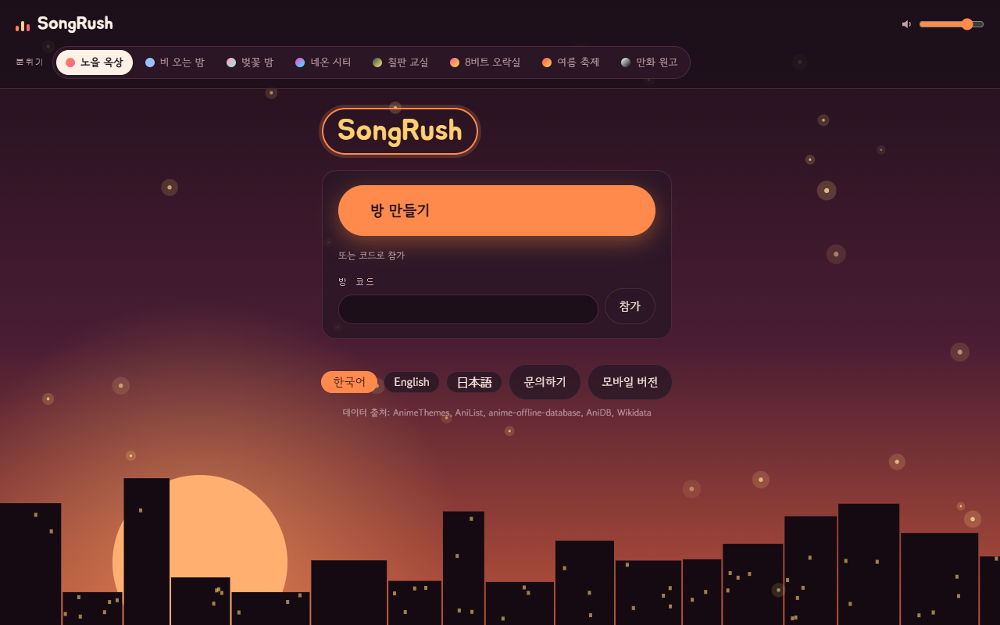
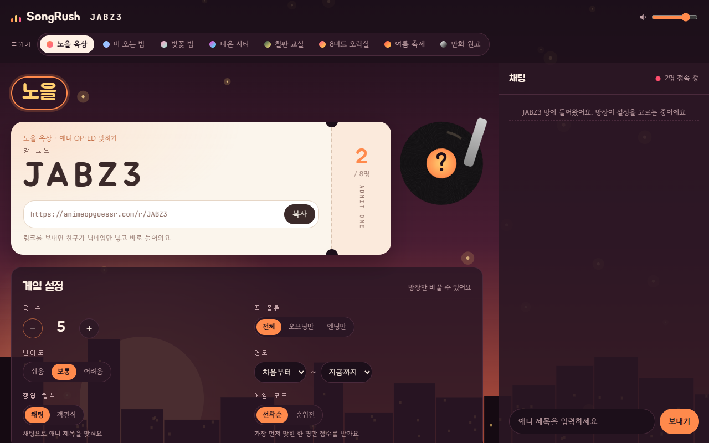
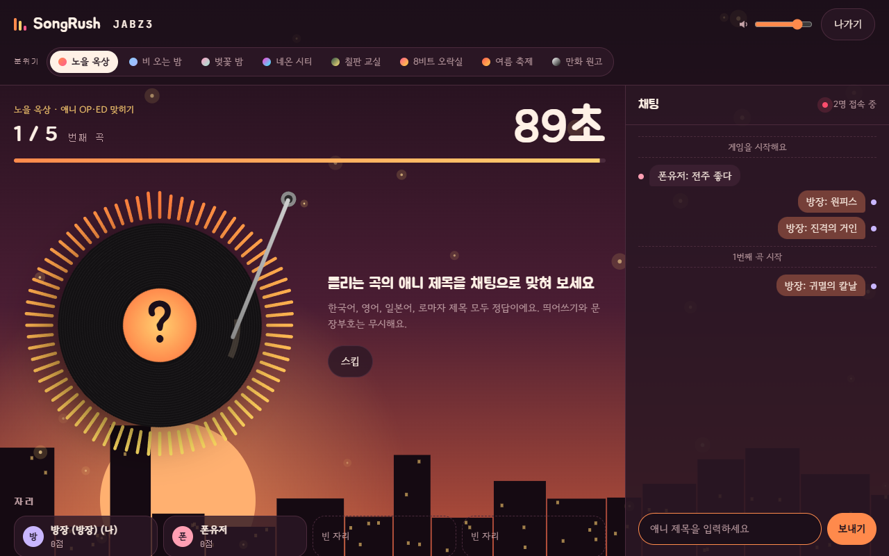
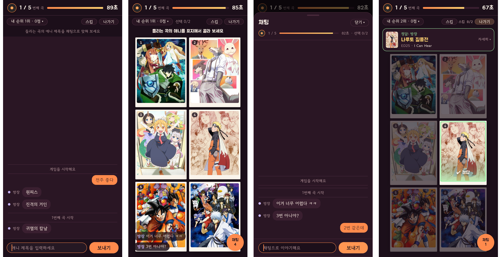
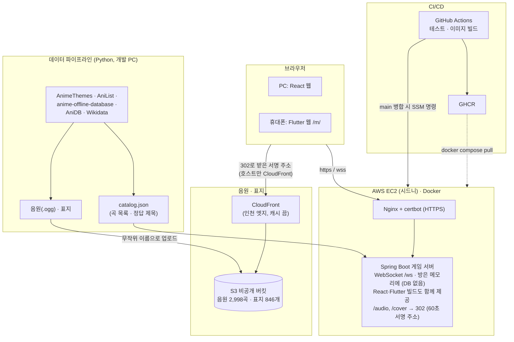
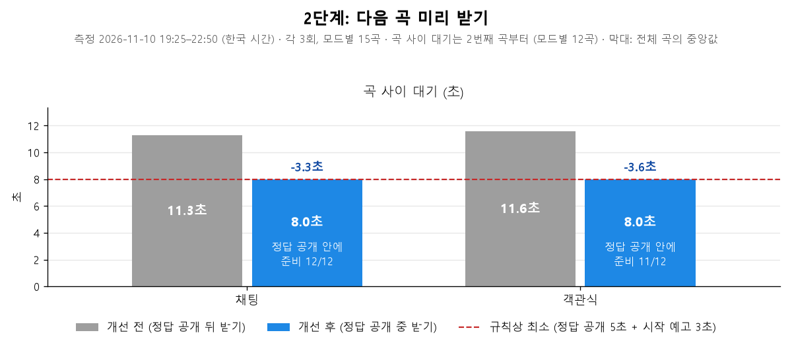

# SongRush

> 같은 순간, 같은 노래. 누가 먼저 애니 제목을 맞힐까?

친구들과 방에 모여 **애니메이션 오프닝·엔딩(OP/ED)을 듣고 제목을 맞히는** 실시간 멀티플레이 웹 게임입니다.
방에 있는 모두가 **같은 곡을 같은 순간에** 듣고, 채팅으로 제목을 치거나 표지 중 하나를 골라 맞힙니다.
PC는 React 웹으로, 휴대폰은 Flutter로 만든 모바일 전용 웹(`/m/`)으로 같은 서버에 접속해 함께 플레이합니다.

- 서비스: **https://animeopguessr.com**
- 기간: 2026.11.02 ~ 진행 중
- 개발: 1인 개발. 코드는 AI 에이전트 팀이 정해진 절차에 따라 쓰고, 제가 방향과 규칙을 정하고 서버 운영과 배포를 직접 맡았습니다([개발 방식](#개발-방식))
- 스택: Spring Boot (WebSocket) · React · Flutter Web · Python · AWS (EC2 · S3 · CloudFront) · Docker · GitHub Actions


## 시연

**PC(왼쪽)와 휴대폰(오른쪽)이 같은 방에서 한 곡을 진행하는 장면.** 양쪽의 채팅이 서로에게 바로 보이고, 둘 다 스킵에 투표하면 곡이 넘어가면서 정답 카드가 두 화면에 동시에 뜹니다.


<details>
<summary>PC 화면 더 보기 (시작 · 대기실 · 채팅 모드)</summary>





</details>

<details>
<summary>모바일 화면 (채팅 모드 · 객관식 · 채팅 시트 · 정답 공개)</summary>



</details>

## 기획 배경

친구들과 노래 맞히기를 할 때 가장 번거로운 건 **"다 같이 같은 순간에 듣는 것"** 입니다. 한 사람이 노래를 틀고 나머지가 화면 공유나 통화로 듣는 방식은 지연이 제각각이라 누가 먼저 맞혔는지 공정하게 가리기 어렵습니다.

- 음악 퀴즈 사이트 songspot.co의 **게임 방식**(방 코드로 모이기, 동시에 듣기, 먼저 맞히면 득점)을 참고하되, 화면·브랜딩·문구는 따라 하지 않았습니다.
- 주제는 **애니메이션 OP/ED**로 좁혔습니다. 같은 노래를 들어도 사람마다 애니 제목을 한국어·영어·일본어·로마자로 다르게 기억하므로, 어느 언어로 쳐도 정답이 되게 했습니다.
- 출제곡은 AnimeThemes의 인기 상위 3,000곡이고, 제목 데이터는 AnimeThemes, AniList, anime-offline-database, AniDB, Wikidata에서 모았습니다.

## 게임 규칙

1. **방 만들기**: 방장이 방을 만들고 코드나 링크(`/r/코드`)를 보내면 최대 8명이 들어옵니다. 같은 닉네임에는 번호가 붙습니다.
2. **설정 (방장)**: 곡 수 5~100(기본 10), 오프닝/엔딩, 연도, 난이도, 그리고 아래 두 가지를 고릅니다. 참가자 화면에도 그대로 보입니다.
   - 정답 형식: **채팅**(제목을 직접 입력) 또는 **객관식**(표지 4·6·8장 중 하나를 고르기, 곡마다 한 번)
   - 점수 방식: **선착순**(서버에 먼저 도착한 정답 1명만 득점) 또는 **순위전**(모두 한 번씩 답하고 도착 순으로 3·2·1점)
3. **재생**: 곡은 처음부터 최대 90초 동안 모두에게 같은 순간에 나옵니다. 접속한 인원의 과반이 스킵에 투표하면 바로 넘어갑니다.
4. **채팅 정답 판정**: 시리즈의 공식 제목(한국어·영어·일본어·로마자) 중 하나와 같으면 정답입니다. 공식 제목이 없을 때만 별칭을 인정합니다. 띄어쓰기·문장부호·대소문자·전각/반각은 무시하지만 철자는 정확해야 하고, 자동완성은 없습니다. 시도 횟수는 무제한이며 도배 방지 한도(연속 5개, 초당 2개)만 있습니다.
5. **정답 공개**: 선착순은 첫 정답에서, 순위전은 모두가 답했을 때 정답 카드가 뜹니다. 공개 뒤에도 음악은 시간 제한까지 계속 나옵니다.
6. **그 밖에**: 게임 도중 들어온 사람은 다음 곡부터 참여하고, 끊겼다가 다시 접속하면 같은 곡 위치로 돌아옵니다. 한 판이 끝나면 대기실로 돌아갑니다. 화면은 한국어·영어·일본어를 지원합니다.

## 주요 기능

| PC 웹 (React) | 모바일 웹 (Flutter, `/m/`) |
| --- | --- |
| 방 만들기·코드/링크로 참가, 닉네임 입력 창 | 휴대폰으로 사이트나 방 링크를 열면 자동으로 `/m/`으로 이동 (PC 버전 링크로 전환 가능) |
| 대기실: 방장 설정(곡 수, 곡 종류, 연도, 난이도, 정답 형식, 점수 방식), 대기실 채팅 | 같은 서버·같은 프로토콜로 PC와 한 방에서 플레이 |
| 방 분위기 8종(노을 옥상, 비 오는 밤, 벚꽃 밤 등): 분위기마다 레코드·배경·정답 액자가 다름 | 휴대폰 한 화면에 맞춘 게임 배치, 객관식 방의 채팅 말풍선과 전체 화면 채팅 시트 |
| 게임: 남은 시간, 스킵 투표, 실시간 점수, 정답 공개 카드(4개 언어 제목·곡 정보·표지), 최종 순위 | 재접속·새로고침 후 같은 곡 위치로 복귀, 게임 중 화면 꺼짐 방지 |
| 음량 조절, 언어 전환(ko/en/ja), 문의하기 | 첫 로딩 진행률과 게임 팁을 보여 주는 로딩 화면 |
| 관리자 화면: 들어온 문의를 검토해 GitHub 이슈로 보내기 | 화면 문구는 웹의 번역 사전에서 가져와 세 언어 지원 |

## 시스템 구성



- **게임 서버** (`backend/`): 방, 라운드 시계, 정답 판정, 점수를 모두 서버가 관리합니다. 방 상태는 메모리에만 있고 DB는 쓰지 않습니다. React 빌드와 Flutter 웹 빌드(`/m/`)도 같은 서버가 정적 파일로 내려 줍니다(`Dockerfile`의 3단계 빌드).
- **음원 전달** (`backend/src/main/java/com/songrush/audio/`): 클라이언트는 `/audio/<무작위 토큰>`만 받습니다. 서버는 이 요청에 60초짜리 S3 서명 주소로 302 응답을 하는데, 주소의 호스트만 CloudFront 도메인으로 바꿉니다(`CdnUrls.java`, `S3AudioLinks.java`). 서명 검사는 S3가 그대로 하고, 주소마다 서명이 달라 CloudFront 캐시는 끄고 가까운 엣지 연결만 씁니다.
- **CI/CD** (`.github/workflows/`): `dev`·`main`에 올리면 백엔드·프론트·모바일 테스트를 돌리고 Docker 이미지를 GHCR에 올립니다. `main`에 합치면 AWS Systems Manager(SSM)로 서버에 새 이미지를 받아 재시작하고 `/health`를 확인합니다. 서버에 SSH로 들어가지 않고 배포됩니다.
- **데이터** (`data/`): 곡 목록과 정답 제목을 만들고 음원·표지를 내려받아 S3에 올리는 도구입니다. 외부 사이트에는 한 번에 한 요청, 2~3초 간격, 응답 캐시를 지킵니다. 테스트는 저장된 응답만 쓰고 네트워크를 막아 둡니다.

## 기술적 고민과 해결

### 1. 모두가 같은 순간에 듣기
- **문제** 서버가 "지금 재생"이라고 보내도 메시지가 도착하는 시간과 기기의 소리 출력 지연이 사람마다 달라, 그대로 틀면 먼저 듣는 사람이 생깁니다. 노래 맞히기에서는 곧 불공정입니다.
- **해결**
  - 서버는 곡마다 미래의 시작 시각 `startAt`(준비 완료 + 3초)을 서버 시계로 정해 보냅니다. 모든 클라이언트가 음원을 받고 준비됐다고 알릴 때까지(최대 25초) 기다린 뒤입니다.
  - 클라이언트는 ping/pong을 여러 번 보내 왕복 시간(RTT)이 가장 짧은 3개 표본의 중앙값으로 서버 시계와의 차이를 추정합니다(`frontend/src/net/clockSync.js`).
  - 재생은 타이머가 아니라 오디오 엔진의 시계에 예약하고, 브라우저가 알려 주는 출력 지연(`outputLatency`)만큼 앞당깁니다. 늦게 도착했으면 늦은 만큼 건너뛴 위치부터 틉니다(`frontend/src/audio/playback.js`).
  - Flutter 앱은 같은 계산을 Dart로 옮기고 웹의 테스트 값도 그대로 옮겨 결과가 같은지 확인했습니다(`mobile/packages/songrush_core/lib/src/sync/`). 재생 중에는 1초마다 위치를 확인해 40ms 넘게 어긋나면 바로잡습니다.
- **결과** 시험 측정에서 오디오 엔진 예약은 시작 오차 2.5ms, 타이머 방식은 18.9ms였습니다. 에뮬레이터 소리를 직접 녹음해 PC와 비교했을 때 시작 시각을 300ms 옮기면 실제 소리도 약 300ms 옮겨져, 시작이 노린 시각에 떨어지는 것을 확인했습니다(`docs/cycles/142-audio-spike.md`).

### 2. 정답 유출 막기와 공정성
- **문제** 브라우저 개발자 도구만 열어도 받은 데이터가 다 보입니다. 음원 주소나 곡 id 하나로도 정답을 알아낼 수 있습니다.
- **해결**
  - 정답, 라운드 시계, 점수는 서버만 가집니다. 정답 공개 전까지 곡 이름, 가수, AnimeThemes의 애니·곡 id는 클라이언트로 보내지 않습니다.
  - 음원 주소는 곡마다 새로 만드는 무작위 토큰(`/audio/<token>`)이고, S3의 파일 이름도 무작위입니다.
  - 객관식 방의 보기 표지는 섞어서 보내고 정답 표시는 넣지 않습니다.
  - **허용한 단 하나의 예외**: 곡 사이 대기를 줄이려고 정답 공개 화면(5초) 동안 다음 곡을 미리 받습니다. 조작한 클라이언트라면 그 5초만큼 먼저 들을 수 있으므로, 이 동안 다음 곡 정답과 같은 채팅은 **보낸 사람에게만** 보이게 했습니다(D-119, D-120). 정답 공개 전에 먼저 친 정답 채팅도 같은 방식으로 처리합니다.
- **결과** 이 규칙들은 `contracts/protocol.md`에 메시지별로 적혀 있고, 공정성 버그(한 사람만 먼저 듣는 문제)는 리뷰에서 가장 높은 등급으로 다룹니다.

### 3. 동시에 들어온 정답 판정
- **문제** 두 사람이 거의 동시에 정답을 치면 서로 다른 스레드에서 처리되어 둘 다 득점하거나, 화면마다 승자가 다르게 보일 수 있습니다.
- **해결** 방마다 전용 스레드 하나(`ExecutorGameScheduler`, 단일 스레드 `ScheduledExecutorService`)를 두고, 그 방으로 들어오는 모든 메시지와 타이머를 이 스레드에서만 처리합니다. `Room`은 락 없이 이 스레드에서만 호출되므로, 먼저 큐에 들어온 정답이 곡을 끝내고 나중 정답은 이미 공개 단계에서 일반 채팅이 됩니다. 지연 보정은 하지 않고 **서버 도착 순서**만 기준으로 삼았습니다(D-016).
- **결과** 실제 소켓으로 두 클라이언트가 같은 정답을 동시에 보내는 테스트에서 승자는 한 명이고, 모든 클라이언트가 같은 순서를 봅니다(`RankedSocketTest.concurrentCorrectChatsAreRankedByArrival`, `ChoiceSocketTest.concurrentCorrectPicksHaveOneWinner`).

### 4. 곡 준비 대기 줄이기
- **문제** 곡마다 "음원을 불러오는 중"에서 5~10초, 회선이 나쁘면 20초 넘게 기다렸습니다. 측정해 보니 곡당 3.6MB 음원을 시드니 S3에서 한국으로 직접 받는 속도(0.2~0.6MB/s)가 원인이었습니다.
- **해결** 측정 스크립트로 실제 사이트에서 전후를 각 3회 재며 한 단계씩 고쳤습니다(`docs/performance.md`).
  1. **CloudFront 경유**: 서명 주소의 호스트만 CloudFront로 바꿔 인천 엣지에 접속하게 했습니다. 서버 코드 한 곳과 설정 한 줄로 켜고 끌 수 있게 해 같은 날 번갈아 쟀습니다.
  2. **정답 공개 중 미리 받기**: 다음 곡 준비 신호를 정답 공개가 끝난 뒤가 아니라 시작될 때 보내, 5초 동안 쉬던 네트워크를 쓰게 했습니다.
  3. **모바일 첫 로딩 압축**: Flutter 웹은 첫 화면 전에 약 13MB(CanvasKit 5.3MB 등)를 압축 없이 받고 있었습니다. 서버의 응답 압축을 켜고(음원은 제외), 앱 글꼴도 18MB에서 2.9MB로 줄였습니다.
- **결과**
  - 음원 대기: 채팅 **9.7초 → 2.4초**, 객관식 9.3초 → 2.7초 (받는 속도 0.38 → 1.53MB/s)
  - 곡 사이 대기: 채팅 **11.3초 → 8.0초**, 객관식 11.6초 → 8.0초. 남은 8초는 정답 공개 5초와 시작 예고 3초로, 게임 규칙상 최소치입니다.
  - 모바일 첫 로딩 전송량: 약 13MB → 약 4.4MB (`docs/cycles/156-compression.md`, `157-loading-diagnostics.md`)

| CloudFront 전후 | 미리 받기 전후 |
| --- | --- |
|  |  |

### 5. React 웹과 Flutter 앱이 같은 서버 쓰기
- **문제** 휴대폰용 Flutter 앱을 새로 만들면서 서버는 그대로 두기로 했습니다. 웹의 `session.js`를 읽어 가며 맞추면 메시지 하나가 바뀔 때 두 클라이언트가 조용히 어긋납니다.
- **해결**
  - WebSocket 프로토콜을 `contracts/protocol.md`에 계약으로 정리했습니다. 클라이언트 메시지 12종, 서버 메시지 20종의 필드, 보내는 시점, 받는 사람, 공개 전에 숨기는 정보까지 적었습니다.
  - 서버 메시지 예시는 손으로 쓰지 않고, 백엔드 소켓 테스트가 실제로 주고받은 프레임을 캡처해 `contracts/messages/`에 저장했습니다.
  - `ProtocolContractTest`가 문서의 메시지 목록, 예시 파일, 서버 코드가 처리하고 보내는 메시지 종류가 서로 같은지 검사합니다. 메시지를 추가하고 문서를 고치지 않으면 테스트가 실패합니다.
- **결과** Flutter 앱은 이 계약을 기준으로 만들었고, 게임 프로토콜을 하나도 바꾸지 않고 PC 웹과 같은 방에서 플레이합니다(`docs/cycles/144-protocol-contract.md`).

### 6. 모바일 웹의 키보드 버그
- **문제** 실제 휴대폰(Chrome)으로 플레이하던 중, 객관식 방 채팅에서 메시지를 보내고 키보드를 내리면 화면이 키보드 높이만큼 줄어든 채로 멈추는 문제를 발견했습니다. 에뮬레이터에서는 재현이 달라 첫 수정(`161`)은 휴대폰에서 효과가 없었습니다.
- **해결**
  - 휴대폰의 실제 값을 보려고 `?debug=1`에서만 뜨는 진단 표시(뷰포트 크기, Flutter 화면 높이, 포커스 등)를 넣었습니다(`162`).
  - Flutter 3.50 웹 엔진 소스에서 원인을 찾았습니다. 엔진은 **텍스트 입력 중이면 브라우저 크기 변화를 무시하고, 입력 중이 아니면 보이는 영역 높이를 따릅니다.** 그런데 보내기 버튼이 입력칸 바깥에 있어서, 누르는 순간 입력이 잠깐 풀렸다 다시 잡히고, 그 틈에 키보드가 움직이면서 키보드가 열린 높이가 화면 크기로 굳어졌습니다.
  - 보내기 버튼을 입력칸의 `TextFieldTapRegion` 안에 넣어 입력 연결이 끊기지 않게 했습니다(`mobile/lib/ui/chat_panel.dart`). 키보드가 내려간 지 300ms가 지나도 화면이 창보다 작으면 엔진이 다시 재게 하는 보호 장치도 넣었습니다(`mobile/lib/platform/stale_view_guard.dart`).
- **결과** 엔진 규칙을 흉내 낸 위젯 테스트에서, 같은 순서를 재현하면 수정 전에는 화면이 844px 대신 544px로 남고 수정 후에는 844px로 돌아옵니다(`docs/cycles/163-send-keeps-focus.md`). 실제 휴대폰에서의 재확인은 아직 남아 있습니다.

## 기술 스택

| 영역 | 사용 기술 |
| --- | --- |
| Backend | Java 17, Spring Boot 4.1, Spring WebSocket(직접 정의한 JSON 메시지), AWS SDK for Java v2 (S3 서명 주소), JUnit 5 |
| Frontend (PC) | React 19 (JavaScript, TypeScript 미사용), Vite 8, react-i18next, Web Audio API, Vitest |
| Mobile | Flutter 3.50 (웹 우선), flutter_soloud, web_socket_channel, 게임 로직은 순수 Dart 패키지 `songrush_core`로 분리 |
| Data | Python 3.12, pytest (외부 접속 차단, 저장된 응답으로만 테스트) |
| Infra | AWS EC2 (시드니) · S3 · CloudFront, Docker, Nginx, certbot, GitHub Actions, GHCR, AWS Systems Manager |

## 개발 방식

이 프로젝트는 **AI 에이전트가 코드를 쓰고, 사람은 방향과 결정만 맡는** 방식으로 만들었습니다. 그 과정 자체를 [`docs/vibe-coding-system.md`](docs/vibe-coding-system.md)에 근거(커밋, 명령 출력)와 함께 기록했습니다.

- **사이클 단위 진행**: `BACKLOG.md`의 작업 하나가 한 사이클입니다. 사이클마다 `cycle/NNN` 브랜치를 만들고, 기록을 `docs/cycles/NNN-*.md`에 남긴 뒤 `dev`에 합칩니다. `main`(배포)에는 제가 직접 합칩니다.
- **역할 분리**: 메인 세션(lead)은 명세·위임·병합만 하고 제품 코드를 쓰지 않습니다. implementer가 코드와 테스트를 쓰고, **코드를 쓴 쪽이 검증하지 않도록** verifier가 테스트를 실행하고 변경을 검토합니다. 배포 전에는 critic이 배포될 변경 전체를 반론 관점에서 검토합니다.
- **증거만 인정**: "됐다"는 말이 아니라 실제로 실행한 명령 출력만 통과로 칩니다.
- **장치로 강제**: hook이 `main` 커밋·강제 푸시·히스토리 재작성을 막고, 작업을 마칠 때 바뀐 영역의 테스트를 자동으로 돌립니다. 결정이 필요하거나 막힌 작업이 생기면 Discord로 알립니다.
- **사람의 결정은 기록으로**: 게임 규칙, 스택, 비용처럼 되돌리기 비싼 선택은 제가 정하고 `BACKLOG.md`에 `D-NNN`으로 남깁니다(D-001 ~ D-146). 진행 상황은 `PROGRESS.md`에 한국어 보고서로 쌓입니다.

| 지표 (2026-11-20 기준) | 값 |
| --- | --- |
| 커밋 | 945개 |
| 사이클 기록 (`docs/cycles/`) | 137개 (사이클 012 ~ 166) |
| 설계 문서 (`docs/design/`) | 23개 |
| 기록된 결정 | 141개 (D-001 ~ D-146) |

## 한계와 향후 과제

- **안드로이드 앱**: 모바일 웹이 휴대폰에서 안정적으로 돌면 같은 Flutter 코드로 APK를 만듭니다(서명 키는 제가 직접 관리).
- **CloudFront 캐시**: 지금은 S3 서명 주소를 그대로 쓰기 때문에 주소마다 서명이 달라 엣지 캐시를 못 씁니다. CloudFront 자체 서명 주소로 바꾸면 캐시를 쓸 수 있지만 서버에 별도 키 관리가 필요합니다.
- **음원 크기**: 곡당 약 3.6MB(316kbps 원본)입니다. 앞 90초만 96kbps로 다시 저장하면 약 1.1MB로 줄어 느린 회선에서도 여유가 생깁니다(추정).
- **Flutter 웹 첫 로딩**: 압축 후에도 약 4.4MB이고 LTE에서 10초 안팎 걸립니다. 지금은 진행률과 안내 문구로 기다림을 덜어 주는 수준입니다.
- **STOMP 전환 보류**: 설계(S-005)까지 마쳤지만, 지금의 WebSocket 프로토콜로 충분해 구현은 미뤄 두었습니다.
- **DB 없음**: 방 상태가 서버 메모리에만 있어 서버가 재시작되면 진행 중인 방이 모두 끝납니다. 배포가 곧 게임 중단입니다.
- **음원 저작권**: 음원은 AnimeThemes에서 받아 씁니다. 앱 스토어에 정식으로 출시하려면 음원 이용 권리를 먼저 검토해야 합니다.

<details>
<summary>프로젝트 구조 · 실행 방법</summary>

```
backend/    Spring Boot 게임 서버 (game: 방·라운드·판정, ws: WebSocket, audio·cover: 음원·표지 전달, feedback: 문의)
frontend/   React 웹 (PC)
mobile/     Flutter 모바일 웹 (/m/), packages/songrush_core: 순수 Dart 게임 로직
data/       Python 데이터 도구 (곡 목록·정답 제목 빌드, 음원·표지 받기, S3 업로드)
contracts/  WebSocket 프로토콜 계약(protocol.md)과 실제 메시지 예시, 정답 비교 공유 테스트 벡터
deploy/     첫 배포(2026-11-04) 때의 설치 스크립트 (현재 운영은 Docker + GHCR + SSM)
docs/       사이클 기록, 설계 문서, 성능 측정, 개발 방식 문서, README 이미지
Dockerfile  React · Flutter 웹 · Spring Boot를 한 이미지로 빌드
```

사전 준비: JDK 17, Node.js, Python 3.12, (모바일) Flutter 3.50

```bash
# 테스트
cd backend  && ./gradlew test            # Windows: .\gradlew.bat test
cd frontend && npm ci && npm test        # lint: npm run lint, build: npm run build
cd data     && python -m venv .venv && .venv/bin/python -m pip install -r requirements.txt && .venv/bin/python -m pytest
cd mobile/packages/songrush_core && dart test
cd mobile   && flutter analyze && flutter build web --release --base-href /m/ --no-web-resources-cdn
```

로컬 실행:

```bash
# 1. 게임 서버 (http://localhost:8080). 기본으로 ../data 의 catalog.json 과 audio-cache/ 를 읽습니다.
cd backend && ./gradlew bootRun

# 2. PC 웹 (http://localhost:5173, /ws·/audio·/cover 는 8080으로 프록시)
cd frontend && npm run dev

# 3. 모바일 웹: mobile/ 에서 빌드한 뒤 서버의 정적 파일 위치로 지정 (자세한 방법은 mobile/README.md)
```

> 음원 파일은 저장소에 없습니다(용량과 저작권). `data/catalog.json`은 저장소에 있지만, 로컬에서 곡을 들으려면 `python -m songrush_data.audio`로 음원을 `data/audio-cache/`에 받아야 합니다. 외부 사이트에 부담을 주지 않도록 요청 간격을 두기 때문에 오래 걸립니다.

</details>
