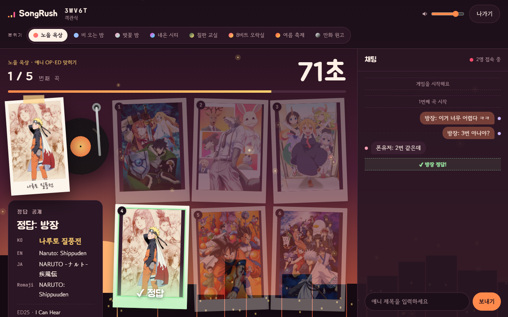
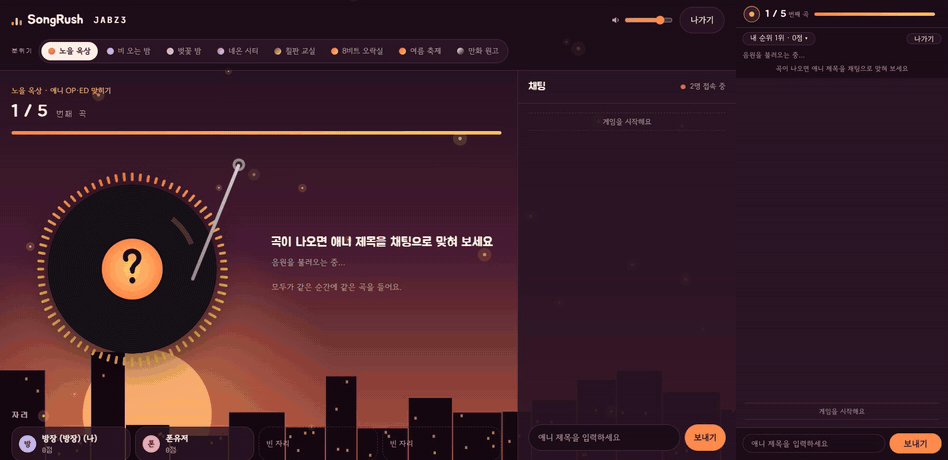
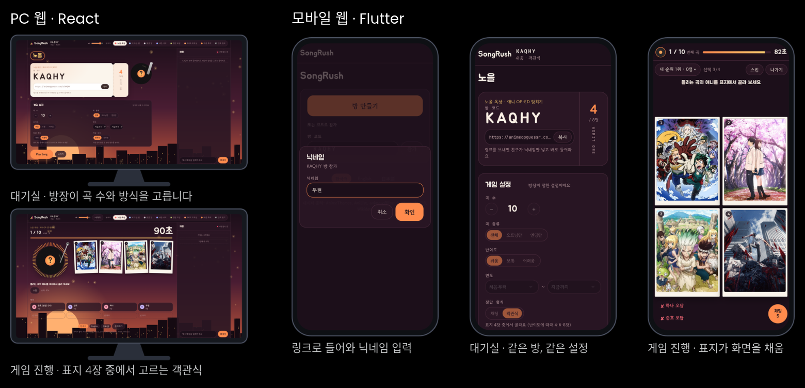
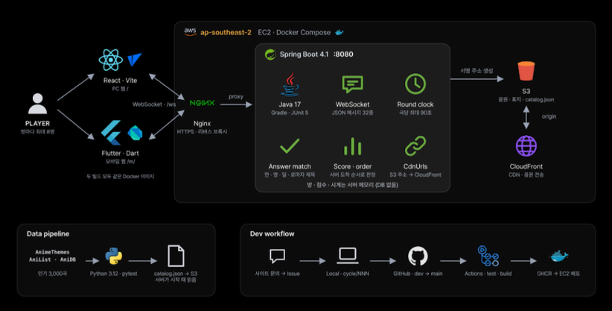
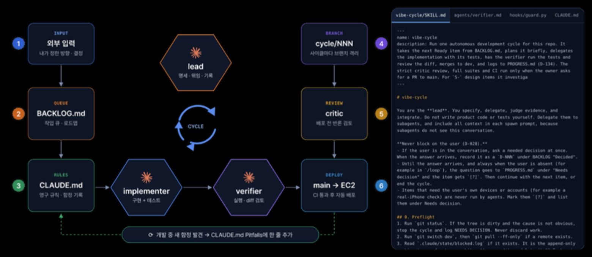
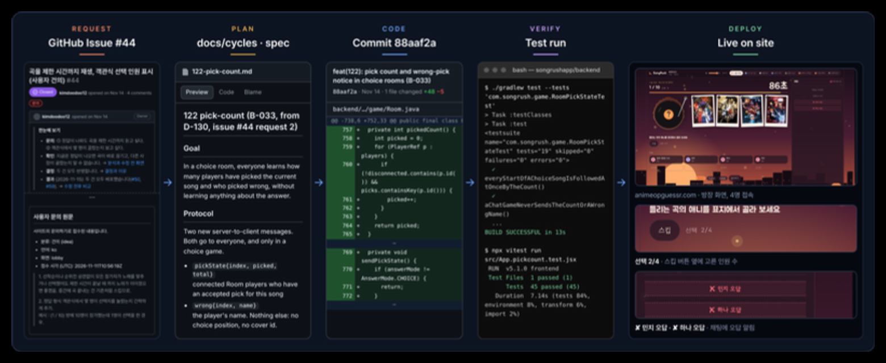
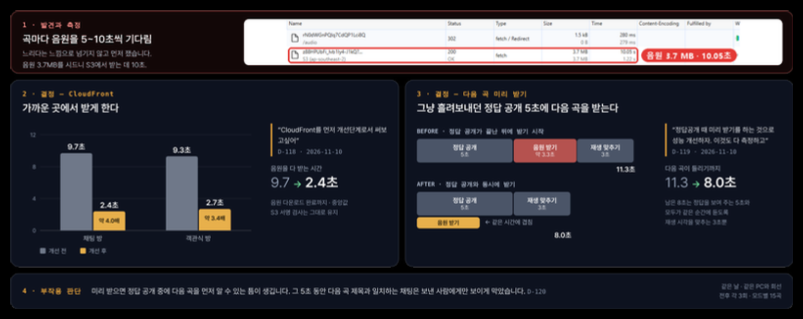

# SongRush

> 같은 순간, 같은 노래. 누가 먼저 애니 제목을 맞힐까?

최대 8명이 한 방에 모여 **애니메이션 오프닝·엔딩을 같은 순간에 듣고**, 제목을 먼저 맞히는 실시간 멀티플레이 게임입니다.
**AI 에이전트 팀을 직접 설계해**, 혼자서 기획부터 운영 배포까지 18일 만에 만들었습니다.

- 서비스: **https://animeopguessr.com**
- 기간: 2026.11.02 ~ 운영 중 (1인 개발 + AI 에이전트)
- 스택: Spring Boot (WebSocket) · React · Flutter · Python · AWS (EC2 · S3 · CloudFront) · Docker · GitHub Actions



## 시연

**PC(왼쪽)와 휴대폰(오른쪽)이 같은 방에서 한 곡을 진행하는 장면** — 채팅이 서로에게 바로 보이고, 스킵이 통과하면 정답 카드가 두 화면에 동시에 뜹니다.



**PC는 React, 휴대폰은 Flutter** — 화면은 둘이지만 같은 서버, 같은 WebSocket 프로토콜로 한 방에서 플레이합니다.



## 핵심 성과

| | 결과 | 방법 |
| --- | --- | --- |
| 🎧 동시 재생 | 시작 오차 **2.5ms** (타이머 방식 18.9ms) | 서버 시계 기준 시작 시각 + 오디오 엔진 예약 |
| ⚡ 곡 로딩 | 음원 대기 **9.7초 → 2.4초**, 곡 사이 **11.3초 → 8.0초** | 측정으로 병목을 찾고 CloudFront 경유, 미리 받기 |
| 🏁 공정한 판정 | 동시에 친 정답도 **서버 도착 순으로 1명만** 득점 | 방마다 단일 스레드, 정답·시계·점수는 서버만 보유 |
| 🤖 AI 개발 체계 | 커밋 **949개**, 사이클 기록 **147개**, 결정 기록 **146개** | 구현·검증·비평 에이전트 분리, hook으로 규칙 강제 |

## 게임 방식

1. 방장이 방을 만들고 링크를 보내면 최대 8명이 들어옵니다.
2. 방장이 곡 수와 함께 **정답 형식**(채팅으로 제목 입력 / 표지 중 고르기)과 **점수 방식**(선착순 / 순위전)을 고릅니다.
3. 모두에게 같은 곡이 같은 순간에 최대 90초 나오고, 한국어·영어·일본어·로마자 제목 중 무엇으로 쳐도 정답입니다.
4. 정답이 나오면 정답 카드가 뜨고 다음 곡으로 넘어갑니다.

<details>
<summary><b>자세한 규칙</b></summary>

1. **방 만들기**: 방장이 방을 만들고 코드나 링크(`/r/코드`)를 보내면 최대 8명이 들어옵니다. 같은 닉네임에는 번호가 붙습니다.
2. **설정 (방장)**: 곡 수 5~100(기본 10), 오프닝/엔딩, 연도, 난이도, 그리고 아래 두 가지를 고릅니다. 참가자 화면에도 그대로 보입니다.
   - 정답 형식: **채팅**(제목을 직접 입력) 또는 **객관식**(표지 4·6·8장 중 하나를 고르기, 곡마다 한 번)
   - 점수 방식: **선착순**(서버에 먼저 도착한 정답 1명만 득점) 또는 **순위전**(모두 한 번씩 답하고 도착 순으로 3·2·1점)
3. **재생**: 곡은 처음부터 최대 90초 동안 모두에게 같은 순간에 나옵니다. 접속한 인원의 과반이 스킵에 투표하면 바로 넘어갑니다.
4. **채팅 정답 판정**: 시리즈의 공식 제목(한국어·영어·일본어·로마자) 중 하나와 같으면 정답입니다. 공식 제목이 없을 때만 별칭을 인정합니다. 띄어쓰기·문장부호·대소문자·전각/반각은 무시하지만 철자는 정확해야 하고, 자동완성은 없습니다. 시도 횟수는 무제한이며 도배 방지 한도(연속 5개, 초당 2개)만 있습니다.
5. **정답 공개**: 선착순은 첫 정답에서, 순위전은 모두가 답했을 때 정답 카드가 뜹니다. 공개 뒤에도 음악은 시간 제한까지 계속 나옵니다.
6. **그 밖에**: 게임 도중 들어온 사람은 다음 곡부터 참여하고, 끊겼다가 다시 접속하면 같은 곡 위치로 돌아옵니다. 한 판이 끝나면 대기실로 돌아갑니다. 화면은 한국어·영어·일본어를 지원합니다.

</details>

## 시스템 구성



- **게임 서버**: 방·라운드 시계·정답 판정·점수를 모두 서버가 쥡니다. React와 Flutter 빌드도 같은 서버가 내려 줘, 이미지 하나로 배포됩니다.
- **음원 전달**: 클라이언트는 `/audio/<무작위 토큰>`만 받고, 서버가 60초짜리 S3 서명 주소로 보내 줍니다. 주소의 호스트만 CloudFront로 바꿔 가까운 엣지(인천)로 받습니다.
- **배포**: `main`에 합치면 GitHub Actions가 테스트 → 이미지 빌드(GHCR) → SSM으로 EC2에 배포 → `/health` 확인까지 합니다. SSH 접속 없이 배포됩니다.
- **DB를 쓰지 않은 이유**: 방 상태는 몇 분짜리 휘발성 데이터라 서버 메모리에 두고, 방마다 단일 스레드에서만 다뤄 락 없이 순서를 보장했습니다.

## AI 에이전트 개발 체계

"AI가 짜 준 코드"가 아니라 **"AI가 쓴 코드를 믿을 수 있게 만드는 구조"**를 직접 설계했습니다. 저는 방향과 결정을 맡고, 역할을 나눈 에이전트들이 사이클 단위로 개발합니다.



| 내가 한 일 | AI 에이전트가 한 일 |
| --- | --- |
| 게임 규칙·제품 방향 결정 (`D-001`~`D-146`) | 명세에 맞춘 코드와 테스트 작성 (implementer) |
| 서버 권한 구조, 동기화 방식 등 설계 판단 | 테스트 실행과 변경 검토 (verifier) |
| **에이전트 역할·절차·hook 설계** | 배포 전 반론 검토 (critic) |
| 실기기에서 버그 발견, 측정 결과로 개선 방향 결정 | 재현·측정 스크립트 작성과 실행 |
| AWS 구성, 배포 승인 (`main` 병합은 나만) | 사이클·설계·성능 기록 작성 |

- **코드를 쓴 쪽은 검증하지 않는다** — 구현과 검증 에이전트를 분리하고, 실제로 돌린 명령 출력만 통과로 칩니다.
- **규칙은 장치로 강제한다** — `guard.py` hook이 `main` 커밋·강제 푸시·히스토리 재작성을 막고, Stop hook이 바뀐 영역의 테스트를 자동으로 돌립니다.
- **실수는 규칙으로 남긴다** — 같은 실패가 두 번 나면 `CLAUDE.md`에 한 줄씩 쌓아 다음 사이클부터 반복하지 않습니다.

**사례: 사용자 건의 한 건이 운영에 반영되기까지** — 사이트 문의로 들어온 건의(GitHub 이슈 #44)를 명세 → 구현 → 검증 → 배포로 처리한 실제 흐름입니다. 이 건의는 7개 사이클로 나눠 모두 첫 시도에 통과했습니다.



<details>
<summary><b>critic·hook이 실제로 막은 문제들</b></summary>

- 정답 비교의 "최소 4자" 규칙이 `나루토`, `銀魂` 같은 짧은 제목을 막는 문제, Python `casefold()`와 Java 결과가 83개 문자에서 다른 문제 (사이클 015)
- 재접속 때 끊김과 재연결이 동시에 오면 자리를 영영 잃는 경합 (사이클 042)
- 에이전트가 원격과 갈라진 `dev`를 하드 리셋하려 하자 `guard.py`가 차단, 사람이 확인 후 처리
- 전체 기록: [`docs/vibe-coding-system.md`](docs/vibe-coding-system.md)

</details>

## 기술적 고민과 해결

### 1. 모두가 같은 순간에 듣기
- **문제** 메시지 도착 시간과 기기의 소리 출력 지연이 사람마다 달라, 그냥 틀면 먼저 듣는 사람이 생깁니다.
- **해결** 서버가 미래의 시작 시각 `startAt`을 서버 시계로 정해 보내고, 클라이언트는 ping/pong으로 시계 차이를 추정해 **오디오 엔진 시계에 예약**합니다. 출력 지연(`outputLatency`)만큼 앞당기고, 늦게 도착하면 늦은 만큼 건너뛰어 틉니다. Flutter도 같은 계산을 Dart로 옮겨 같은 테스트 값으로 확인했습니다.
- **결과** 시작 오차 **2.5ms** (타이머 방식 18.9ms)

### 2. 정답 유출 막기와 동시 정답 판정
- **문제** 개발자 도구만 열어도 받은 데이터가 다 보이고, 두 사람이 거의 동시에 정답을 치면 둘 다 득점할 수 있습니다.
- **해결** 정답·시계·점수는 서버만 갖고, 곡 이름이나 id는 공개 전까지 보내지 않습니다. 음원 주소도 무작위 토큰입니다. 방마다 전용 스레드 하나가 모든 메시지를 처리해, **서버에 먼저 도착한 정답 1명만** 득점합니다.
- **결과** 실제 소켓 두 개로 동시에 정답을 보내는 테스트에서 승자는 항상 한 명이고, 모든 화면이 같은 순서를 봅니다.

### 3. 곡마다 5~10초씩 기다리는 문제



- **원인** 곡당 3.6MB 음원을 시드니 S3에서 한국으로 직접 받는 속도(0.2~0.6MB/s).
- **해결** ① 서명 주소의 호스트만 CloudFront로 바꿔 인천 엣지로 받기 ② 정답 공개 5초 동안 다음 곡 미리 받기. 미리 받으면 다음 곡을 먼저 알 수 있는 틈이 생겨, 그 5초 동안 다음 곡 정답과 같은 채팅은 보낸 사람에게만 보이게 막았습니다.
- **결과** 음원 대기 **9.7초 → 2.4초**, 곡 사이 대기 **11.3초 → 8.0초** (남은 8초는 게임 규칙상 최소치). 측정 기록: [`docs/performance.md`](docs/performance.md)

## 기술 스택

| 영역 | 사용 기술 |
| --- | --- |
| Backend | Java 17, Spring Boot 4.1, Spring WebSocket, AWS SDK v2, JUnit 5 |
| Frontend (PC) | React 19, Vite 8, react-i18next, Web Audio API, Vitest |
| Mobile | Flutter 3.50 (웹 우선), flutter_soloud, 순수 Dart 게임 로직 패키지 |
| Data | Python 3.12, pytest |
| Infra | AWS EC2 · S3 · CloudFront, Docker, Nginx, GitHub Actions, GHCR, SSM |
| AI 개발 | Claude Code, 에이전트(implementer · verifier · critic), hook, Discord 알림 |

## 향후 과제

- **안드로이드 앱**: 같은 Flutter 코드로 APK 배포 (지금의 모바일 웹은 그 전 단계)
- **회원과 전적**: DB를 붙여 곡별 정답률, 랭킹 저장
- **음원 경량화**: 앞 90초·96kbps로 줄이면 곡당 3.6MB → 약 1.1MB (추정)

<details>
<summary><b>주요 기능 (PC · 모바일)</b></summary>

| PC 웹 (React) | 모바일 웹 (Flutter, `/m/`) |
| --- | --- |
| 방 만들기·코드/링크로 참가, 닉네임 입력 창 | 휴대폰으로 사이트나 방 링크를 열면 자동으로 `/m/`으로 이동 (PC 버전 링크로 전환 가능) |
| 대기실: 방장 설정(곡 수, 곡 종류, 연도, 난이도, 정답 형식, 점수 방식), 대기실 채팅 | 같은 서버·같은 프로토콜로 PC와 한 방에서 플레이 |
| 방 분위기 8종(노을 옥상, 비 오는 밤, 벚꽃 밤 등): 분위기마다 레코드·배경·정답 액자가 다름 | 휴대폰 한 화면에 맞춘 게임 배치, 객관식 방의 채팅 말풍선과 전체 화면 채팅 시트 |
| 게임: 남은 시간, 스킵 투표, 실시간 점수, 정답 공개 카드(4개 언어 제목·곡 정보·표지), 최종 순위 | 재접속·새로고침 후 같은 곡 위치로 복귀, 게임 중 화면 꺼짐 방지 |
| 음량 조절, 언어 전환(ko/en/ja), 문의하기 | 첫 로딩 진행률과 게임 팁을 보여 주는 로딩 화면 |
| 관리자 화면: 들어온 문의를 검토해 GitHub 이슈로 보내기 | 화면 문구는 웹의 번역 사전에서 가져와 세 언어 지원 |

</details>

<details>
<summary><b>프로젝트 구조 · 실행 방법</b></summary>

```
backend/    Spring Boot 게임 서버 (game: 방·라운드·판정, ws: WebSocket, audio·cover: 음원·표지 전달, feedback: 문의)
frontend/   React 웹 (PC)
mobile/     Flutter 모바일 웹 (/m/), packages/songrush_core: 순수 Dart 게임 로직
data/       Python 데이터 도구 (곡 목록·정답 제목 빌드, 음원·표지 받기, S3 업로드)
contracts/  WebSocket 프로토콜 계약(protocol.md)과 실제 메시지 예시, 정답 비교 공유 테스트 벡터
deploy/     첫 배포(2026-11-04) 때의 설치 스크립트 (현재 운영은 Docker + GHCR + SSM)
docs/       사이클 기록, 설계 문서, 성능 측정, 개발 방식 문서, README 이미지
Dockerfile  React · Flutter 웹 · Spring Boot를 한 이미지로 빌드
```

사전 준비: JDK 17, Node.js, Python 3.12, (모바일) Flutter 3.50

```bash
# 테스트
cd backend  && ./gradlew test            # Windows: .\gradlew.bat test
cd frontend && npm ci && npm test        # lint: npm run lint, build: npm run build
cd data     && python -m venv .venv && .venv/bin/python -m pip install -r requirements.txt && .venv/bin/python -m pytest
cd mobile/packages/songrush_core && dart test
cd mobile   && flutter analyze && flutter build web --release --base-href /m/ --no-web-resources-cdn
```

로컬 실행:

```bash
# 1. 게임 서버 (http://localhost:8080). 기본으로 ../data 의 catalog.json 과 audio-cache/ 를 읽습니다.
cd backend && ./gradlew bootRun

# 2. PC 웹 (http://localhost:5173, /ws·/audio·/cover 는 8080으로 프록시)
cd frontend && npm run dev

# 3. 모바일 웹: mobile/ 에서 빌드한 뒤 서버의 정적 파일 위치로 지정 (자세한 방법은 mobile/README.md)
```

> 음원 파일은 저장소에 없습니다(용량과 저작권). `data/catalog.json`은 저장소에 있지만, 로컬에서 곡을 들으려면 `python -m songrush_data.audio`로 음원을 `data/audio-cache/`에 받아야 합니다. 외부 사이트에 부담을 주지 않도록 요청 간격을 두기 때문에 오래 걸립니다.

</details>
