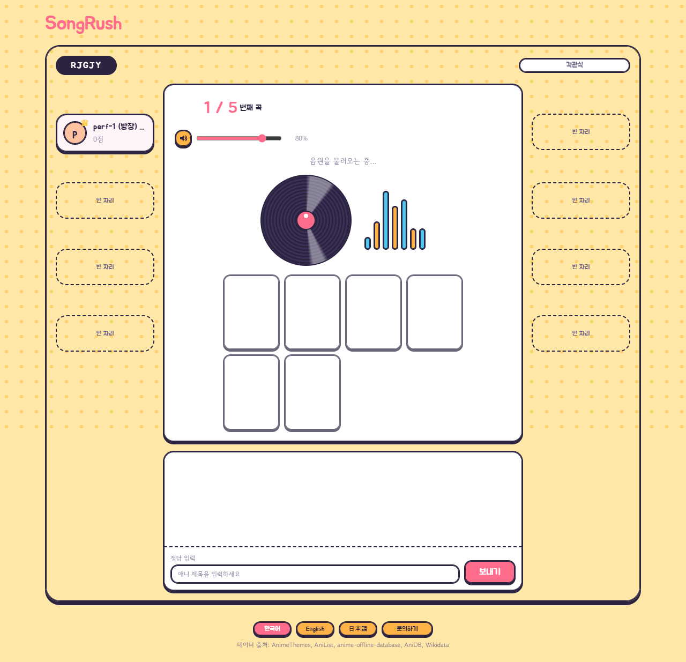
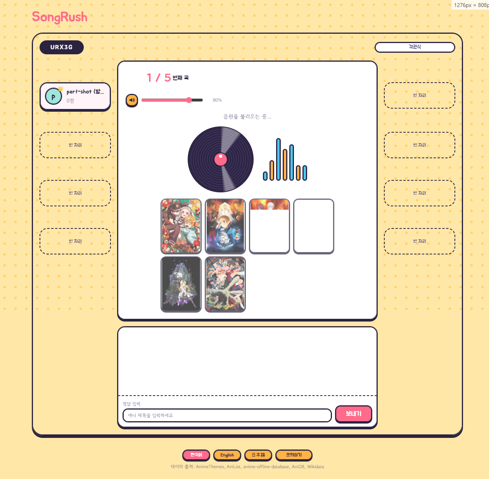
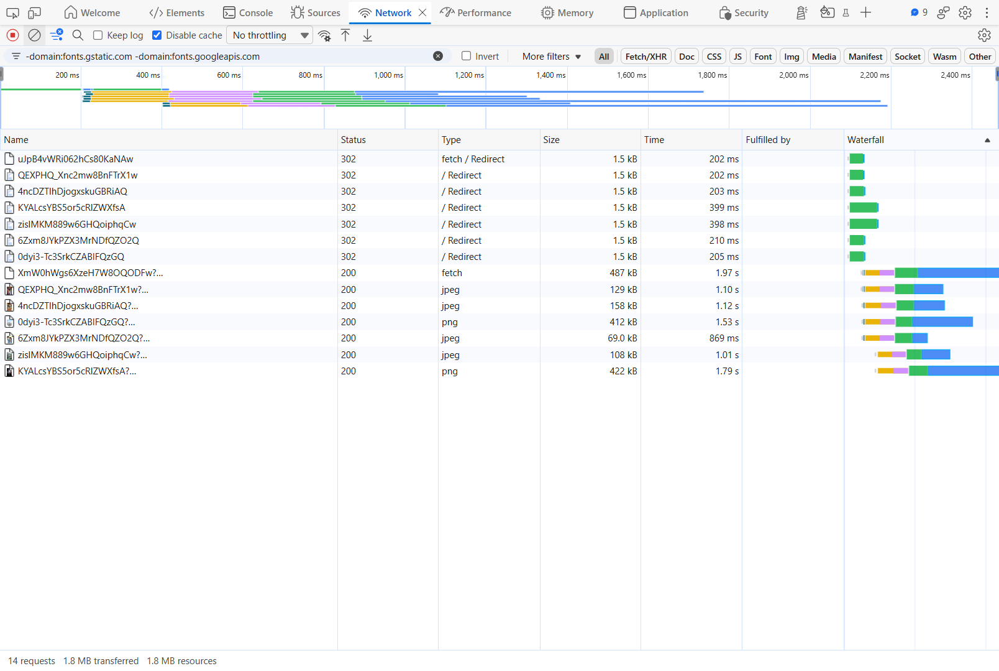
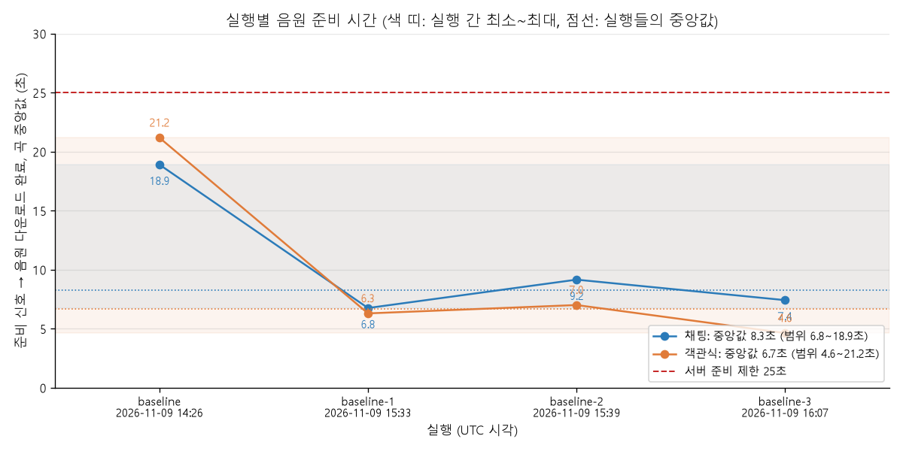
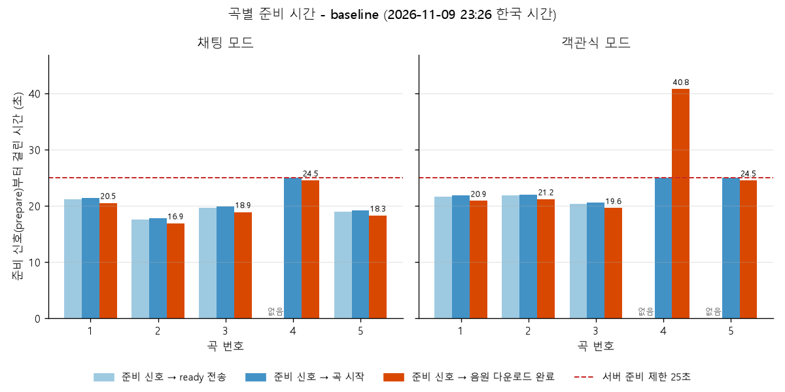
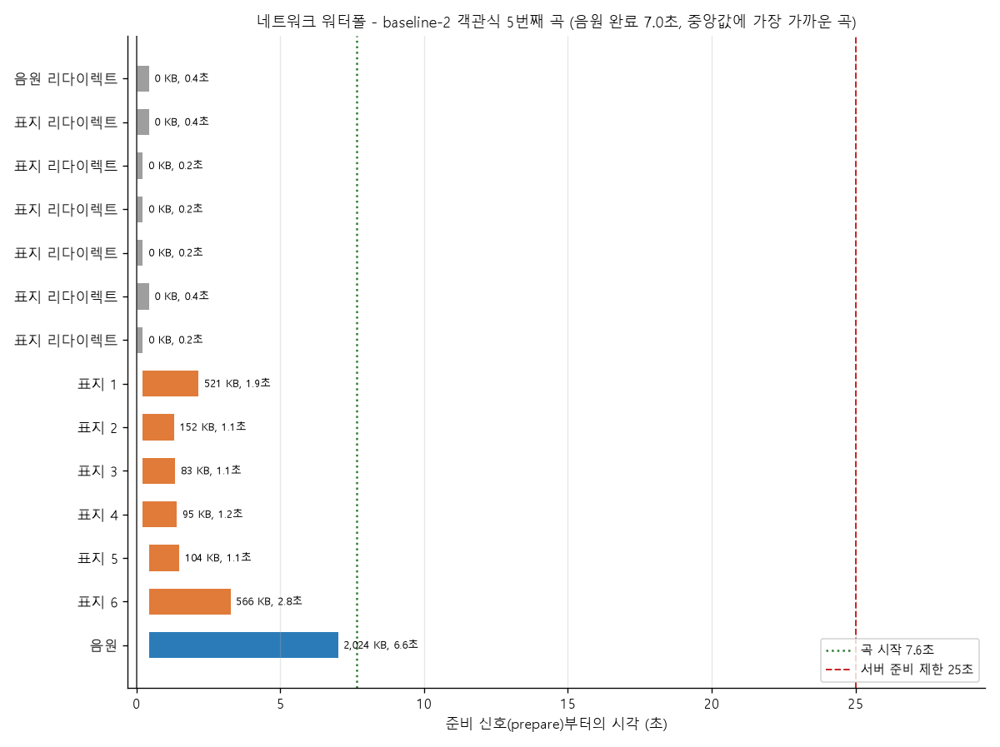
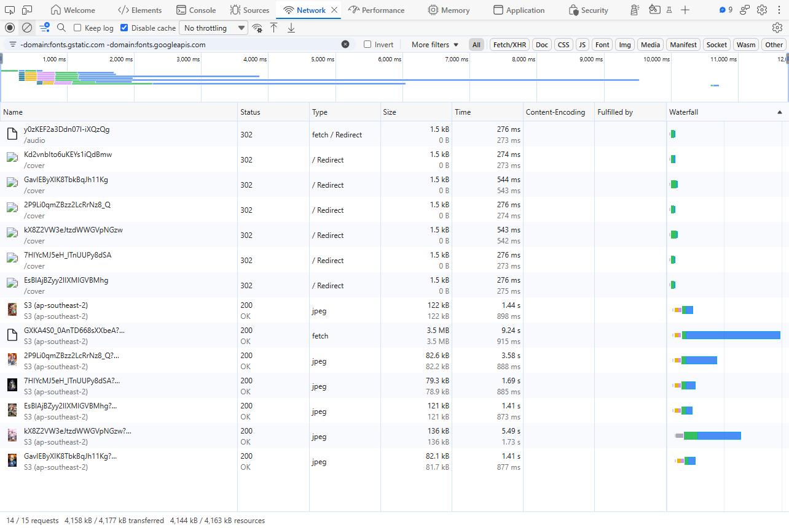
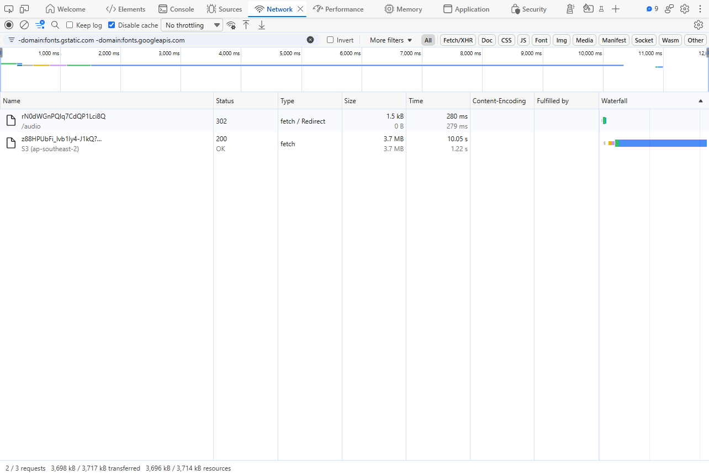
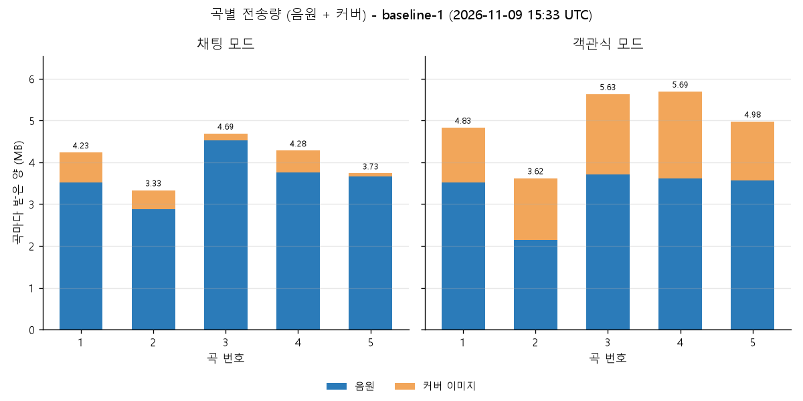
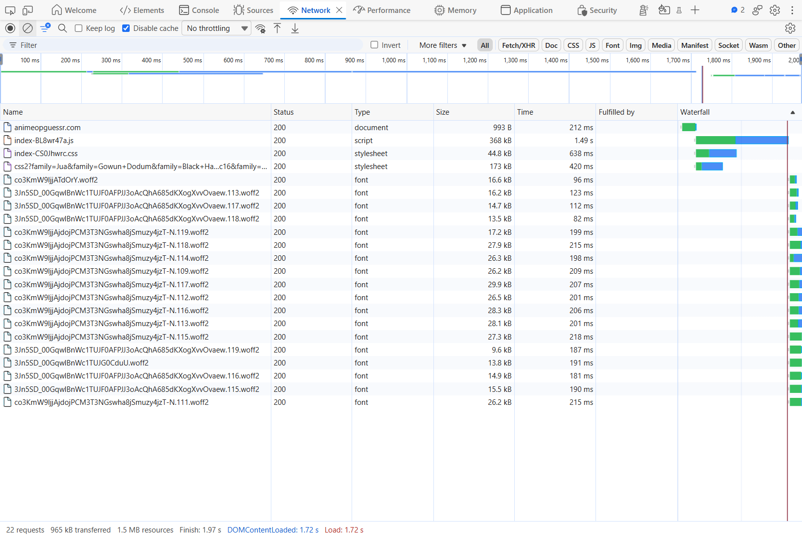

# SongRush 성능 보고서 (상세): 곡 준비 대기 시간

> 요약본은 [performance.md](performance.md)입니다. 이 문서는 측정 방법, 근거, 한계, 재현 명령까지 모두 담은 상세본입니다.

> 순서: **1. 문제 → 2. 측정 방법 → 3. 기준값 → 4. 원인 분석 → 5. 개선 후보 → 6. 개선 기록**
> 이 문서의 숫자는 모두 `perf/results/`의 결과 파일이나 부록 A의 재현 명령과 그 출력에서 왔습니다. 기준값 측정 시각은 한국 시간 2026-11-09 23:26 ~ 11-10 01:07입니다. 개발자 도구 캡처(캡처 A~D)의 수치는 그 이미지에서 읽은 값입니다.

---

## 0. 용어

| 용어 | 뜻 |
|---|---|
| 준비 신호 | 서버가 "다음 곡을 준비하라"고 보내는 신호. 음원 주소와 객관식 보기 표지가 함께 옵니다 |
| 준비 완료 | 플레이어가 "음원과 표지를 다 받았다"고 서버에 알리는 신호 |
| 시작 신호 | 서버가 정한 곡 시작 시각. 실제 재생은 이 신호를 받고 3초 뒤입니다 |
| 1~4회차 | 기준값 측정 4번. 그래프와 결과 파일에서는 각각 `baseline`, `baseline-1`, `baseline-2`, `baseline-3`입니다 |
| 중앙값, p10, p90 | 값을 크기순으로 늘어놓았을 때 가운데 값 / 아래에서 10% 위치 값 / 아래에서 90% 위치 값 |
| kbps | 소리 1초에 쓰는 데이터 양. 클수록 음질이 좋고 파일이 큽니다 |
| Opus | 이 게임 음원의 압축 형식(Ogg 파일 안에 들어 있음) |
| gzip | 파일을 보내기 전에 압축하는 방식. 받는 쪽이 자동으로 풀어 씁니다 |
| 일회용 다운로드 주소 | 일정 시간만 쓸 수 있는 서명이 붙은 S3 다운로드 주소(presigned URL) |
| HAR | 브라우저 네트워크 요청 기록 파일. Chrome 개발자 도구에 불러와 볼 수 있습니다 |
| 워터폴 | 요청마다 시작과 끝을 가로 막대로 그린 그림 |
| CDN | 사용자 가까이에 파일 사본을 두는 배포망 |

---

## 1. 문제

플레이어는 곡마다 **"음원을 불러오는 중..."** 화면에서 기다립니다. 객관식 정답 형식이 생긴 뒤로는 곡마다 표지 이미지 4~8장도 함께 받아야 해서, 기다리는 시간이 더 길게 느껴진다는 지적이 나왔습니다(2026-11-09).



*그림 1. 객관식 방의 곡 준비 화면(실제 사이트, 3회차). 음원을 받는 동안 보기 표지 6칸이 비어 있습니다.*

브라우저 개발자 도구(F12 → Network)로 보면 이렇습니다.




*캡처 A. 객관식 곡의 준비 중(2026-11-10 10:00 KST, 실제 사이트, `perf/devtools_shot.py`). 아래는 Edge 개발자 도구 Network 탭(게임 시작 후 약 2.4초), 위는 그 약 2초 뒤의 게임 화면입니다.*
- *개발자 도구 시점에 표지는 4장을 받았고 2장은 아직 받는 중입니다. 약 2초 뒤의 게임 화면에서도 1칸은 비어 있고 1칸은 그리는 중입니다.*
- *음원(Type `fetch`, Status 200인 행)은 3.5 MB 중 **244 kB**만 받은 상태입니다. 다 받는 데는 9.24초가 걸렸습니다(캡처 B).*
- *위 7행(Status 302)은 사이트 서버가 음원·표지마다 일회용 S3 주소로 돌려보내는 응답입니다. 이것만으로 요청마다 0.27~0.54초가 걸립니다(4.2).*
- *이름 칸의 서명 부분(`?` 뒤)과 저장소 주소(`S3 (ap-southeast-2)`로 표시)는 캡처 전에 가렸습니다.*
- *그림 1(3회차)은 표지가 아직 하나도 뜨지 않은 더 이른 순간입니다. 캡처 A처럼 표지가 먼저 뜨고, 그 뒤에도 음원 때문에 기다리는 경우가 많습니다(4.1).*

이 대기 시간이 실제로 얼마나 되는지, 무엇 때문에 생기는지를 측정과 증거로 정리합니다.

---

## 2. 측정 방법

### 2.1 무엇을 재는가
한 곡은 서버에서 다음 순서로 진행됩니다(`backend/src/main/java/com/songrush/game/Room.java`).

```
정답 공개(5초) → 준비 신호 → 각자 음원·표지 다운로드 → 준비 완료
→ 시작 신호(재생 3초 전 통보) → 재생(최대 90초)
```

- **곡 시작 조건:** 방의 **모든 플레이어가 준비 완료를 보내거나**, 준비 신호 후 **25초가 지나면** 시작 신호를 보냅니다(`PREPARE_TIMEOUT = 25s`). 실제 재생은 그 3초 뒤입니다(`LEAD = 3s`).
- **늦은 플레이어:** 그때까지 음원을 다 받지 못한 플레이어는 받는 즉시 **이미 재생 중인 위치부터** 듣습니다(`frontend/src/audio/playback.js`). 즉 **곡의 앞부분을 놓칩니다.**
- **곡 사이 체감 대기:** "정답 공개 5초 + 준비 신호→시작 신호 + 3초"입니다.

| 지표 | 뜻 | 쓰임 |
|---|---|---|
| **준비 신호 → 음원 다운로드 완료** | 준비 신호부터 음원 파일을 다 받을 때까지 | **핵심 지표.** 상한이 없어 개선 효과가 그대로 드러남 |
| **곡 시작 전 준비 완료 k/N** | N곡 중 25초 제한에 걸리지 않고 준비 완료를 보낸 곡 수 | 서버가 기다리다 못해 곡을 시작한 횟수를 보여 줌 |
| 앞부분을 놓친 곡 | 음원 완료가 실제 재생 시각(시작 신호 + 3초)보다 늦은 곡 | 플레이어 피해 |
| 준비 신호 → 시작 신호 | 준비 신호부터 시작 신호까지 | **25초 상한이 있음.** 곡 사이 대기 계산에 사용 |
| 곡당 음원 크기, 받는 속도 | 음원 바이트, MB/초 | 원인 분석 |
| 곡당 표지 바이트 | 객관식 보기 표지 합계 | 원인 분석 |
| JS 크기와 압축 여부, 첫 화면 로딩 | 사이트 첫 진입 | 원인 분석 |

### 2.2 측정 도구
- **도구:** `perf/run.py`(Playwright + Edge). 실제 사이트에 들어가 방을 만들고 **채팅 5곡, 객관식 5곡**을 진행하며 곡마다 위 지표를 기록합니다.
- **곡끼리 대역을 나눠 쓰지 않게:** 각 곡의 다운로드가 끝난 뒤 스킵합니다.
- **누락 없이:** 네트워크 요청은 곡별로 나눠 집계하고, 실패한 요청과 끝나지 않은 요청도 기록합니다.
- **남기는 것:**
  - 원본 데이터: `perf/results/*.json`
  - 네트워크 기록: `perf/results/*.har`(서명 제거)
  - 화면 캡처: `perf/results/shots/`
  - 그래프: `perf/report.py`가 `docs/perf/`에 만듭니다.
- **보안:**
  - 일회용 다운로드 주소의 서명 부분은 저장 전에 지웁니다.
  - 저장 전에 `X-Amz-`, `Signature=`, `Credential=`를 검사해서 하나라도 남아 있으면 저장하지 않습니다.
  - 결과 4개와 HAR 6개 모두 검사 결과는 0건입니다.

- **측정 화면 캡처:** `perf/devtools_shot.py`가 실제 Edge 개발자 도구(Network 탭)를 열고 첫 화면 로딩, 객관식 1곡, 채팅 1곡을 진행하며 화면을 그대로 찍습니다(캡처 A~D).
  - 곡 캡처는 게임 시작 직전에 Network 기록을 비워 **그 곡의 요청만** 보이게 했습니다. 글꼴 요청은 필터로 뺐습니다.
  - 찍기 전에 화면의 서명 부분을 지우고, 찍은 뒤 화면 글자를 다시 검사해 서명이 하나라도 있으면 그 이미지를 버리고 다시 찍습니다.
  - 캐시를 끈 상태(`Disable cache`)로 찍습니다. 처음 방문한 사람이 받는 양이 그대로 보입니다.
  - 저장소(S3) 주소에는 AWS 계정 번호가 들어 있어서, 화면에서 `S3 (ap-southeast-2)`로 바꾼 뒤 찍습니다.

다시 재는 법은 부록 A에 있습니다.

### 2.3 측정 환경
| 항목 | 값 |
|---|---|
| 클라이언트 | Windows 11, Microsoft Edge 156, 한국, 가정용 회선(유선/Wi-Fi 미기록) |
| 서버 | AWS EC2 ap-southeast-2(호주 시드니) |
| 음원·표지 저장소 | S3 ap-southeast-2(시드니), 일회용 다운로드 주소로 직접 다운로드 |
| 사이트 버전 | `index-BL8wr47a.js`(4회 모두 동일) |
| 사이트(EC2)까지 연결 | TCP 0.20~0.24초, TLS 0.42~0.47초(부록 A-3) |

### 2.4 측정 방식에서 바로잡은 함정
- **처음 지표의 문제:** 처음에는 "준비 신호 → 시작 신호" 시간을 기록했습니다. 그런데 서버는 음원이 안 와도 25초가 지나면 곡을 시작하므로, 이 값은 **음원이 아무리 느려도 25초를 넘지 않습니다.**
- **첫 측정의 결과:** 10곡 중 7곡이 약 25초로 찍혀서, 수치가 사실상 서버 상수였습니다(그 결과는 버리고 다시 쟀습니다).
- **곡끼리 겹침:** 곡을 바로 스킵하면 이전 곡 다운로드가 다음 곡과 겹쳐 대역을 나눠 쓰는 문제도 있었습니다.
- **바로잡은 방법:** 코드 리뷰에서 발견해, 핵심 지표를 상한이 없는 **"음원 다운로드 완료까지"**로 바꾸고 **곡마다 다운로드가 끝난 뒤 넘어가도록** 고쳤습니다.

---

## 3. 기준값

### 3.1 4회 측정 요약
| 실행 | 시각(한국) | 채팅: 준비 완료 | 채팅: 음원 완료 (중앙값) | 객관식: 준비 완료 | 객관식: 음원 완료 (중앙값) | 받는 속도 (중앙값) | 객관식 표지/곡 | 곡 사이 체감 대기 (채팅 / 객관식) |
|---|---|---|---|---|---|---|---|---|
| 1회차 | 11-09 23:26 | 4/5 | **18.9초** | 3/5 | **21.2초** | 0.18 MB/s | 2,020 KB | **27.9초 / 30.0초** |
| 2회차 | 11-10 00:33 | 5/5 | 6.8초 | 5/5 | 6.3초 | 0.56 MB/s | 1,469 KB | 15.7초 / 15.3초 |
| 3회차 | 11-10 00:39 | 5/5 | 9.2초 | 5/5 | 7.0초 | 0.40 MB/s | 1,760 KB | 18.1초 / 15.6초 |
| 4회차 | 11-10 01:07 | 5/5 | 7.4초 | 5/5 | 4.6초 | 0.53 MB/s | 1,835 KB | 16.4초 / 13.4초 |

- **20곡을 모은 값:** 음원 완료 중앙값은 **채팅 7.6초, 객관식 7.0초**입니다. 곡 시작 전 준비 완료는 **채팅 19/20, 객관식 18/20**입니다.
- **앞부분을 놓친 곡:** 40곡 중 1곡(1회차 객관식 4번째 곡)입니다.
- **공통 값:** 음원 1곡 중앙값 약 3.6 MB. JS 367 KB가 **압축 없이** 전송됩니다(응답에 `Content-Encoding` 없음). 첫 화면 로딩은 1.8~3.9초입니다.
- **곡 사이 체감 대기:** 정답 공개 5초 + 준비 신호→시작 신호 중앙값 + 3초로 계산했습니다.
- **출처:** `perf/results/2026-11-09-baseline{,-1,-2,-3}.json`, `perf/README.md`의 표. 20곡 합산과 체감 대기는 부록 A-4의 명령으로 계산했습니다.
- **시각 표기:** 결과 파일 이름의 날짜(2026-11-09)는 UTC 기준입니다. 표와 그래프의 시각은 한국 시간입니다.



*그림 2. 실행별 "준비 신호 → 음원 완료" 중앙값. 빨간 점선은 서버의 25초 준비 제한입니다. 색 띠는 실행 4회 중앙값의 최소~최대입니다.*

### 3.2 실행마다 크게 달랐다 (회선 상태에 따른 변동)
- **차이:** 23:26 실행 1회만 받는 속도가 0.18 MB/s로 느렸고, 음원 완료까지 19~21초 걸렸습니다. 자정 이후 3회는 0.40~0.56 MB/s로 5~9초였습니다. **약 2~3배 차이**입니다.
- **해석:** 같은 PC, 같은 회선, 같은 측정 도구로 쟀으므로 이 차이는 그때그때의 회선 상태에서 온 것으로 봅니다. 느린 실행이 1회뿐이라 특정 시간대의 특성이라고 말하지는 않습니다.
- **의미:** 회선이 나쁠 때는 대기가 3배 가까이 길어지고, 25초 제한에 걸려 곡 앞부분을 놓치는 일이 생깁니다. 개선 효과는 이런 느린 경우에 가장 크게 드러납니다.



*그림 3. 가장 느린 실행(1회차, 23:26)의 곡별 시간.*
- *객관식 4번째 곡은 음원을 다 받기까지 40.8초가 걸렸습니다. 곡은 28초(25초 제한 + 3초 예고)에 이미 재생됐으므로, 이 플레이어는 **앞부분 약 13초를 듣지 못했습니다.***
- *"없음"은 25초 안에 준비 완료를 보내지 못해 서버가 곡을 시작한 곡입니다. 그중 채팅 4번과 객관식 5번은 음원이 24.5초에 끝나 실제 재생(28초) 전에 준비됐습니다.*

### 3.3 측정의 한계
- **플레이어 1명:** 1명으로 쟀습니다. 실제 방(최대 8명)은 **가장 느린 사람이 준비를 마칠 때까지** 기다리므로, 대기는 이 값보다 길 수 있습니다.
- **클라이언트 1대, 회선 1개:** 클라이언트는 한 대, 한 회선입니다(유선/Wi-Fi 미기록).
- **표본 크기:** 실행마다 형식별 5곡입니다. 곡을 무작위로 뽑기 때문에 음원 크기가 곡마다 1.8~4.5 MB로 다릅니다.
- **1회차의 차이:** 측정 도구의 이전 버전으로 쟀고, HAR과 캡처가 없고, 창 크기가 1280×720입니다. 네트워크 수치는 같은 방식으로 쟀습니다.
- **실제 게임과의 차이:** 측정 도구는 다운로드가 끝난 뒤 다음 곡으로 넘어갑니다. 실제 게임에서는 정답이 빨리 나오면 이전 곡 다운로드와 겹칠 수 있습니다.

---

## 4. 원인 분석

### 4.1 음원 파일이 필요 이상으로 크다 (주원인)
- **크기:** 2,998곡 전체에서 음원 크기 중앙값은 **3.57 MB**, 총 10.68 GB입니다.
- **음질:** 비트레이트 중앙값은 **316 kbps**(p10 192, p90 327)입니다. AnimeThemes 원본 Ogg Opus를 **재인코딩 없이 그대로** 쓰기 때문입니다(원본 음질을 지키려고 정한 방식).
- **길이는 주된 원인이 아닙니다:** 게임은 최대 **90초만** 재생합니다(`MAX_PLAY`). 1,954곡이 90초보다 길지만, 90초를 넘는 부분은 전체의 **1.07 GB(10%)**뿐입니다. 크기의 대부분은 **길이가 아니라 음질(비트레이트)** 때문입니다.
- **워터폴로 본 병목:** 그림 4에서 곡 준비 시간을 정하는 것은 **음원 다운로드가 끝나는 시점**입니다. 표지는 그보다 먼저 끝납니다.

출처: 부록 A-1(음원 통계 명령과 출력), 서버 코드 `Room.java`의 `MAX_PLAY = 90s`.



*그림 4. 객관식 곡 하나의 네트워크 워터폴(3회차, "음원 완료" 시간이 그 실행 중앙값에 가장 가까운 곡).*
- *음원 2,024 KB가 6.6초 걸려 가장 마지막에 끝납니다. 이 곡의 음원은 평균(3.6 MB)보다 작은 편입니다.*
- *표지 6장(83~566 KB)은 1~3초 안에 끝납니다.*

개발자 도구로 직접 본 곡 하나도 같습니다.



*캡처 B. 캡처 A와 같은 곡을 다 받은 시점(2026-11-10 10:00 KST).*
- *음원 **3.5 MB에 9.24초**가 걸려 가장 늦게 끝납니다. 표지 6장(79~136 kB)은 1.41~5.49초에 끝납니다.*
- *하단 합계는 14개 요청, 4,158 kB입니다("14 / 15"의 15는 필터로 숨긴 요청까지 센 수입니다).*
- *Size 칸의 두 줄은 위가 전송 크기, 아래가 원본 크기입니다. Time 칸의 아래 줄은 첫 응답까지의 시간입니다. 음원은 0.9초 만에 응답이 시작됐지만, 다 받는 데 9초가 넘게 걸렸습니다. 즉 **응답 대기가 아니라 내려받는 양**이 문제입니다.*



*캡처 C. 채팅 곡 하나(2026-11-10 10:01 KST). 표지 없이 음원 **3.7 MB에 10.05초**입니다. 표지가 없어도 음원 하나가 대기 시간을 정합니다.*

*캡처 A~C는 각각 곡 1개를 한 번 잰 것으로, 3장의 기준값 표에는 들어가지 않습니다. 캐시를 끈 상태(처음 받는 경우)입니다.*

### 4.2 서버와 저장소가 멀다 (속도의 상한)
- **위치와 속도(기준값 측정 당시):** 음원과 표지는 **호주 시드니 S3**에서 직접 받았습니다. 곡별 음원 수신 속도는 0.09~0.91 MB/s였고, 중앙값은 채팅 0.46, 객관식 0.47 MB/s입니다(부록 A-4). 사이트 서버까지는 TCP 연결에만 0.2초 이상 걸립니다(부록 A-3).
- **리다이렉트 왕복:** 음원과 표지는 매번 사이트 서버(시드니)에 먼저 요청해 일회용 S3 주소를 받고(302), 그다음 S3에서 받습니다. 이 한 번에 요청마다 0.27~0.54초가 듭니다(캡처 A의 위 7행).
- **바꾼 방법:** 계정 지역은 시드니로 고정돼 있어 그대로 두고, 서명 방식도 그대로 둔 채 주소의 도메인만 CloudFront로 바꿨습니다(요약본 5장 1단계).
- **그다음:** 남은 대응은 보내는 양을 줄이는 것과 다음 곡을 미리 받는 것입니다.

### 4.3 표지 이미지가 화면에 비해 크다 (객관식의 전송량)
- **표지 846장의 크기:** 중앙값 **123 KB**, p90 549 KB, 최대 856 KB입니다. 300 KB를 넘는 것이 258장이고, 271장이 PNG입니다(부록 A-2).
- **곡당 전송량:** 객관식은 곡마다 표지를 4~8장 받습니다. 기준값에서 **곡당 1.5~2.0 MB**로, 음원의 절반가량을 더 받습니다(그림 5).
- **화면 크기와의 차이:** 화면에 보이는 크기는 보기 칸(약 100×133 px)과 정답 카드뿐인데, 원본은 고해상도 포스터입니다.
- **준비 시간에 대한 영향은 아직 확인되지 않았습니다:**
  - 측정에서 객관식의 음원 수신 속도(0.47 MB/s)는 채팅(0.46 MB/s)과 차이가 없었습니다.
  - 20곡 합산 음원 완료도 객관식이 7.0초로, 채팅 7.6초보다 오히려 빠릅니다.
  - 이 경로에서는 연결 하나의 속도가 한계라서, 표지를 병렬로 받아도 음원이 크게 늦어지지 않는 것으로 보입니다.
  - 정리하면 표지 축소는 **전송량(데이터 사용량, 저속 회선)**을 위한 개선입니다. 준비 시간 효과는 재측정으로 확인합니다.



*그림 5. 곡별 전송량(2회차). 객관식 방에서는 표지(주황)가 곡마다 1.3~2.1 MB를 더합니다.*

### 4.4 다음 곡을 미리 받지 않는다
- **지금 방식:** 서버는 정답 공개 5초가 끝난 뒤에야 다음 곡의 준비 신호를 보냅니다(서버 코드 `Room.java`의 `afterReveal` → `prepare(songIndex + 1)`).
- **결과:** 곡이 재생되는 동안 다음 곡을 받을 시간이 있는데도 쓰지 않아, **곡 사이마다 다운로드 시간이 그대로 대기 시간**이 됩니다. 기준값의 체감 대기는 13~30초입니다(3.1).

### 4.5 첫 화면: JS가 압축되지 않는다
- **압축 여부:** JS 367 KB와 CSS 45 KB를 `Accept-Encoding: gzip, br`로 요청해도 응답에 `Content-Encoding`이 없습니다. 서버에서 압축이 꺼져 있는 것으로 보입니다(부록 A-3).
- **압축하면:** 같은 JS를 gzip으로 압축하면 **115 KB**입니다(부록 A-3).
- **영향 범위:** 첫 화면 로딩(1.8~3.9초)에만 영향을 주고, 게임 중 대기에는 영향이 없습니다.



*캡처 D. 캐시를 끄고 본 첫 화면 로딩(2026-11-10 09:59 KST). 글꼴 파일 행은 필터로 숨겼습니다.*
- *`index-BL8wr47a.js`는 전송 **368 kB**, 원본 367 kB로 거의 같고, **Content-Encoding 칸이 비어 있습니다**. 즉 압축 없이 옵니다.*
- *같은 화면의 Google Fonts 스타일시트(`css2`)는 Content-Encoding이 **gzip**이고, 전송 173 kB, 원본 737 kB입니다. 압축하면 이렇게 줄어든다는 비교입니다.*
- *이 실행에서는 문서(`animeopguessr.com`) 응답이 14.7초로 비정상적으로 느렸습니다. 같은 시각 `curl`로는 0.83~0.90초였으므로, 측정 브라우저 쪽 지연으로 보고 로딩 시간 수치로는 쓰지 않습니다. 첫 화면 로딩 시간은 3장의 측정값(1.8~3.9초)을 씁니다.*

### 4.6 원인 요약
| 원인 | 영향 | 근거 |
|---|---|---|
| 음원 316 kbps, 곡당 3.6 MB (원본 그대로) | **모든 곡의 준비 시간** (주원인) | 4.1, 그림 4 |
| 시드니까지의 거리와 대역 | 모든 다운로드 속도의 상한 | 4.2, 3.2 |
| 다음 곡을 미리 받지 않음 | 곡 사이 대기 전체 | 4.4 |
| 표지 원본 크기 (곡당 +1.5~2 MB) | 객관식 곡의 전송량. 준비 시간 영향은 측정상 확인 안 됨 | 4.3, 그림 5 |
| JS·CSS 압축 없음 | 첫 화면 로딩 | 4.5 |

---

## 5. 개선 후보

원인마다 고칠 방법과 예상 효과를 정리했습니다. **예상치는 모두 추정**입니다. 하나씩 골라 고치고 다시 재서, 그 결과를 요약본의 [개선 단계](performance.md#5-개선-단계)에 단계별로 기록합니다.

| 원인 | 개선 방법 | 예상 효과 (추정) | 고려할 점 |
|---|---|---|---|
| 음원이 원본 고음질 그대로 | 앞 90초만, Opus 96 kbps로 다시 저장 | 곡당 3.6 MB → 약 1.1 MB(약 -70%). 0.18 MB/s 회선에서 약 20초 → 약 6초. 전체 10.7 GB → 약 3.2 GB | 원본 음질을 지키던 방식을 바꾸는 일. 음질을 직접 들어 보고 결정 |
| 다음 곡을 미리 받지 않음 | 서버가 재생 중에 다음 곡 준비 신호를 미리 보내고, 클라이언트가 미리 받음 | 정답이 나오기까지 걸린 시간 + 5초 안에 다운로드가 끝나면 곡 사이 대기가 최소치(정답 공개 5초 + 예고 3초 = 약 8초)에 가까워짐. 정답이 빨리 나오는 곡은 효과가 작음 | 서버 통신 방식 변경. 클라이언트를 조작하면 다음 곡을 미리 들을 수 있음(친구끼리 하는 게임이라 허용한 예외) |
| 표지가 화면에 비해 큼 | 가로 320 px JPEG(품질 80) | 장당 약 20~30 KB, 객관식 곡당 1.5~2 MB → 약 0.15 MB(**전송량** 기준). 준비 시간 효과는 재측정으로 확인 | 표지 846장 변환 후 다시 업로드 |
| JS·CSS 압축 없음 | 웹 서버(Nginx) `gzip on`(js, css, json) | JS 367 KB → 약 115 KB. 첫 화면이 빨라짐 | 서버 설정 한 줄 |
| 서버·저장소가 시드니 | 한국 근처 CloudFront를 거쳐 받기(서명은 S3가 그대로 검사) | 받는 속도 상승 | 요약본 5장 1단계에서 적용. 같은 날 전후 비교로 음원 완료 9.7 → 2.4초(채팅), 9.3 → 2.7초(객관식) |

### 목표 (제안)
- 느린 회선에서도 **곡 시작 전 준비 완료 20/20**, **앞부분을 놓친 곡 0**, 곡 사이 체감 대기 **10초 이하**.

### 비교 규칙
1. **같은 조건으로 재기:** `perf/run.py`, 같은 PC와 회선, 채팅·객관식 각 5곡.
2. **여러 번 재기:** 개선마다 **최소 3회** 재고, 중앙값과 범위(최소~최대), 실행별 받는 속도를 함께 적습니다. 받는 속도가 기준값의 범위(0.18~0.56 MB/s)와 크게 다르면 그 사실을 함께 밝힙니다.
3. **기록:** `perf/README.md`에 한 줄 추가, 그래프와 개발자 도구 캡처를 다시 만들고, 요약본의 [개선 단계](performance.md#5-개선-단계) 표에 전/후를 적습니다.
4. **품질 확인:** 음원 음질(96 kbps)과 표지 화질은 실제 게임 화면과 청취로 확인한 뒤 적용합니다.

---

## 6. 개선 기록

개선 전후 비교는 요약본의 [개선 단계](performance.md#5-개선-단계)에 단계마다 적습니다. 개선마다 쓴 그래프와 캡처도 거기서 링크합니다.

---

## 부록 A. 재현 명령과 출력

### A-0. 측정과 그래프
```bash
python -X utf8 perf/run.py --base https://animeopguessr.com/ --songs 5 --label <이름> --env-note "<회선 설명>"
python -X utf8 perf/report.py --results perf/results/2026-11-09-baseline.json perf/results/2026-11-09-baseline-1.json perf/results/2026-11-09-baseline-2.json perf/results/2026-11-09-baseline-3.json --out docs/perf
```
측정 도구는 Playwright와 matplotlib이 설치된 시스템 Python으로 실행합니다. 단위 테스트는 `data/.venv/Scripts/python.exe -m pytest perf`입니다.

### A-0-1. 개발자 도구 캡처
```bash
python -X utf8 perf/devtools_shot.py --label <날짜> [--views pageload,choice,chat]
```
화면에 Edge 창이 약 3분 동안 뜹니다. 결과는 `perf/results/shots/<날짜>-devtools-*.png`, `<날짜>-game-*.png`입니다.

### A-1. 음원 통계 (`data/audio-cache/index.json`)
```python
import json, statistics as st
v = list(json.load(open('data/audio-cache/index.json', encoding='utf-8')).values())
sz = [x['size'] for x in v]; du = [x['durationMs'] / 1000 for x in v]
br = sorted(x['size'] * 8 / (x['durationMs'] / 1000) / 1000 for x in v if x['durationMs'] > 0)
print(len(v), st.median(sz) / 1e6, sum(sz) / 1e9)                              # 2998  3.574  10.68
print(br[int(.1 * len(br))], st.median(br), br[int(.9 * len(br))])             # 192  316  327 (kbps)
print(sum(d > 90 for d in du), sum(max(d - 90, 0) / d * s for d, s in zip(du, sz)) / 1e9)  # 1954  1.07 (GB)
```

### A-2. 표지 통계 (`data/cover-cache/`)
```python
import os, statistics as st
fs = sorted(os.path.getsize(os.path.join('data/cover-cache', f)) for f in os.listdir('data/cover-cache') if f.endswith(('.jpg', '.png')))
print(len(fs), st.median(fs) / 1e3, fs[int(.9 * len(fs))] / 1e3, fs[-1] / 1e3, sum(x > 300e3 for x in fs))  # 846  123  549  856  258
# PNG: 271
```

### A-3. 사이트 연결과 JS 압축 (2026-11-10 측정)
```bash
curl -s -o /dev/null -w "connect %{time_connect}s tls %{time_appconnect}s ttfb %{time_starttransfer}s\n" https://animeopguessr.com/
# connect 0.227288s tls 0.432450s ttfb 0.631867s
# connect 0.244208s tls 0.471233s ttfb 0.684701s
# connect 0.204442s tls 0.417947s ttfb 0.619411s
curl -s -D - -o /dev/null -H "Accept-Encoding: gzip, br" https://animeopguessr.com/assets/index-BL8wr47a.js | grep -i "content-encoding\|content-length"
# Content-Length: 366957        (Content-Encoding 줄 없음)
curl -s https://animeopguessr.com/assets/index-BL8wr47a.js -o live.js && wc -c < live.js && gzip -9 -c live.js | wc -c
# 366957
# 115065
for i in 1 2 3; do curl -s -o /dev/null -H "Cache-Control: no-cache" -w "doc %{http_code} total %{time_total}s
" https://animeopguessr.com/; done
# (2026-11-10 10:0x KST, 캡처 D 직후) doc 200 total 0.895040s / 0.827500s / 0.849246s
```

### A-4. 20곡 합산, 곡별 수신 속도, 체감 대기
```python
import json, statistics as st
songs = {'chat': [], 'choice': []}
for n in ['', '-1', '-2', '-3']:
    r = json.load(open(f'perf/results/2026-11-09-baseline{n}.json', encoding='utf-8'))
    m = r['medians']
    print(n, {f: round(5 + m[f]['prepareToStart_ms'] / 1000 + 3, 1) for f in songs})  # 곡 사이 체감 대기
    for s in r['songs']: songs[s['format']].append(s)
for f, ss in songs.items():
    done = [s['prepareToAudioDone_ms'] for s in ss if s['prepareToAudioDone_ms']]
    rate = [s['audio']['bytes'] / 1e6 / (s['audio']['total_ms'] / 1000) for s in ss if s['audio']]
    print(f, st.median(done) / 1000, st.median(rate), min(rate), max(rate))
# 출력: 체감 대기 27.9/30.0, 15.7/15.3, 18.1/15.6, 16.4/13.4
#       chat 7.6초, 0.46 MB/s (0.15~0.67) / choice 7.0초, 0.47 MB/s (0.09~0.91)
```

## 부록 B. 관련 파일
- 측정 도구와 표: `perf/run.py`, `perf/report.py`, `perf/README.md`
- 원본 결과, HAR, 캡처: `perf/results/`
- 그래프: `docs/perf/`

## 부록 C. 1단계: 같은 파일 번갈아 받기 확인
CloudFront 적용 전, 실제 사이트의 다운로드 주소 하나를 받아 저장소(S3)에서 직접 받기와 CloudFront를 거쳐 받기를 번갈아 했습니다. 순서는 곡마다 바꿨습니다(2026-11-10 오전). 같은 파일을 몇 초 간격으로 받았으므로 회선 상태와 파일 크기의 영향이 거의 없습니다.

```
song 1 S3 direct  2.99 MB in 9.61 s = 0.31 MB/s
song 1 CloudFront 2.99 MB in 2.10 s = 1.42 MB/s
song 2 CloudFront 3.54 MB in 2.14 s = 1.65 MB/s
song 2 S3 direct  3.54 MB in 13.91 s = 0.25 MB/s
song 3 S3 direct  3.65 MB in 7.10 s = 0.51 MB/s
song 3 CloudFront 3.65 MB in 2.74 s = 1.33 MB/s
```

같은 때의 보안 확인 결과도 있습니다. 정상 서명은 200이었고, 서명을 바꾼 요청, 서명이 없는 요청, 60초가 지나 만료된 요청은 모두 403이었습니다. 403 직후의 정상 요청도 200이어서, 오류 응답이 저장되지 않는 것도 확인했습니다.

적용 후 음원 응답의 `x-amz-cf-pop` 헤더는 `ICN57-P4`였습니다. 인천 엣지에서 받았다는 뜻입니다.
