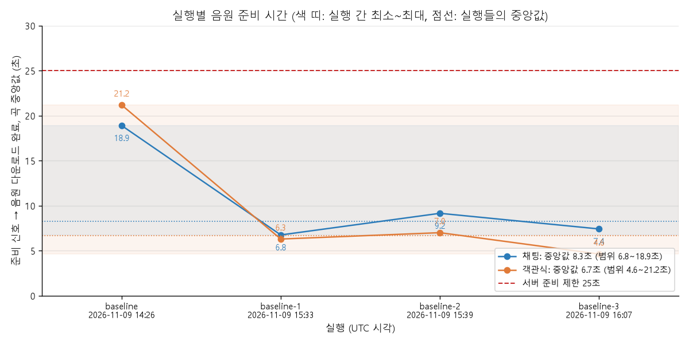
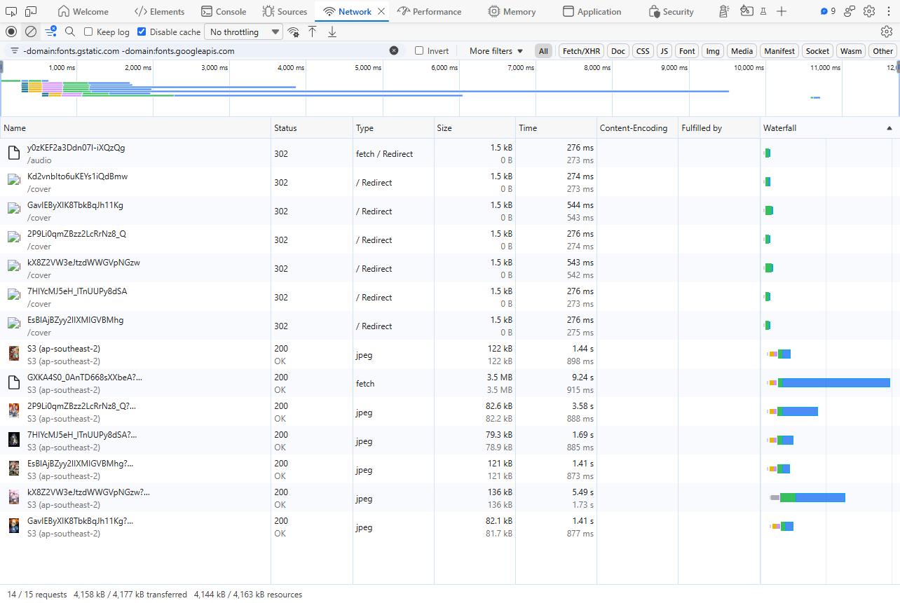
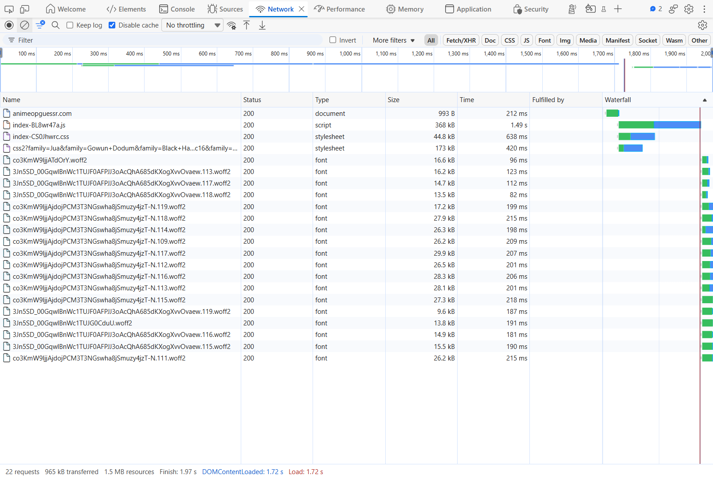

# SongRush 성능 보고서: 곡 준비 대기 시간

> **문제 → 측정 → 원인 → 개선 계획 → 개선 기록** 순서의 요약본입니다. 근거, 측정의 한계, 재현 명령은 [상세본](performance-detail.md)에 있습니다.

## 1. 문제

플레이어는 곡마다 **"음원을 불러오는 중..."** 화면에서 기다립니다. 객관식 정답 형식이 생긴 뒤로 곡마다 표지 4~8장을 더 받게 되면서, 대기가 길다는 지적이 나왔습니다(2026-11-09).

*캡처 A. 객관식 곡의 준비 중(실제 사이트, 2026-11-10 10:00 KST). 아래 개발자 도구 화면에서 표지는 대부분 받았지만, 음원(Type `fetch`, Status 200)은 3.5 MB 중 **244 kB**만 받은 상태입니다. 위 게임 화면은 그 약 2초 뒤입니다.*

## 2. 측정

- **도구:** 직접 만든 `perf/run.py`가 실제 사이트에서 Edge 브라우저로 방을 만들고 **채팅 5곡, 객관식 5곡**을 진행하며 기록합니다. 개발자 도구 화면은 `perf/devtools_shot.py`로 찍습니다.
- **핵심 지표:** 준비 신호(prepare)부터 **음원 다운로드 완료까지의 시간**입니다.
  - 처음에는 "곡 시작까지의 시간"을 쟀습니다. 그런데 서버가 25초가 지나면 무조건 곡을 시작하므로, 이 값은 25초를 넘을 수 없었습니다. 검토에서 이를 발견해 상한이 없는 지표로 바꿨습니다([상세 2.4](performance-detail.md#24-측정-방식에서-바로잡은-함정)).
- **환경:** 한국의 PC 1대와 플레이어 1명으로 쟀습니다. 서버와 음원 저장소는 호주 시드니(AWS)에 있습니다.
- **횟수:** 4회, 2026-11-09 23:26 ~ 11-10 01:07 KST에 쟀습니다.

### 기준값

| 실행 (KST) | 채팅: 음원 완료 | 객관식: 음원 완료 | 받는 속도 | 곡 사이 체감 대기 (채팅 / 객관식) |
|---|---|---|---|---|
| 11-09 23:26 | **18.9초** | **21.2초** | 0.18 MB/s | **27.9초 / 30.0초** |
| 11-10 00:33 | 6.8초 | 6.3초 | 0.56 MB/s | 15.7초 / 15.3초 |
| 11-10 00:39 | 9.2초 | 7.0초 | 0.40 MB/s | 18.1초 / 15.6초 |
| 11-10 01:07 | 7.4초 | 4.6초 | 0.53 MB/s | 16.4초 / 13.4초 |

*각 칸은 그 실행 5곡의 중앙값입니다. 곡 사이 체감 대기는 정답 공개 5초 + 곡 시작까지 + 시작 예고 3초입니다.*

- **보통일 때:** 음원을 다 받기까지 곡당 5~9초 걸렸습니다.
- **느릴 때:** 밤 11시대 실행에서는 19~21초 걸렸습니다. 이때 40곡 중 1곡은 다 받기 전에 곡이 시작돼, 그 플레이어가 **앞부분 약 13초를 놓쳤습니다.**
- **곡 사이 대기:** 13~30초입니다.
- **아직 모르는 것:** 느린 실행이 1번뿐이라, 시간대 때문인지 그때의 회선 상황 때문인지는 아직 구분하지 못했습니다([상세 3.2](performance-detail.md#32-실행마다-크게-달랐다-원인-미확인)). 측정의 한계는 [상세 3.3](performance-detail.md#33-측정의-한계)에 있습니다.

## 3. 원인

*캡처 B. 캡처 A와 같은 곡을 다 받은 시점. 음원 **3.5 MB에 9.24초**가 걸려 가장 늦게 끝납니다. 표지 6장(79~136 kB)은 1.41~5.49초에 끝납니다. 음원은 0.9초 만에 응답이 시작됐으니, 문제는 응답 대기가 아니라 **내려받는 양**입니다.*

| 원인 | 영향 | 근거 |
|---|---|---|
| **음원이 원본 고음질 그대로**: 곡당 중앙값 3.6 MB, 316 kbps | 모든 곡의 준비 시간 (**주원인**) | 캡처 B. 90초를 넘는 부분은 전체의 10%뿐이라 길이보다 음질이 크기를 좌우함 ([상세 4.1](performance-detail.md#41-음원-파일이-필요-이상으로-크다-주원인)) |
| **서버와 저장소가 시드니에 있음** | 모든 다운로드 속도의 상한. 음원·표지마다 서버를 한 번 거치는 데 0.27~0.54초 | 캡처 A의 302 행 ([상세 4.2](performance-detail.md#42-서버와-저장소가-멀다-속도의-상한)) |
| **다음 곡을 미리 받지 않음** | 곡 사이 대기 전체 | 서버가 정답 공개가 끝난 뒤에야 다음 곡 준비를 보냄 ([상세 4.4](performance-detail.md#44-다음-곡을-미리-받지-않는다)) |
| **표지가 화면에 비해 큼** | 객관식 곡당 1.5~2.0 MB를 더 받음. 준비 시간에 대한 영향은 측정으로 확인되지 않음 | [상세 4.3](performance-detail.md#43-표지-이미지가-화면에-비해-크다-객관식의-전송량) |
| **JS가 압축되지 않음** | 첫 화면 로딩만 | 캡처 D |

*캡처 D. 첫 화면 로딩(캐시 끔). 사이트 JS `index-BL8wr47a.js`는 전송 368 kB로 원본과 거의 같고, **Content-Encoding 칸이 비어 있습니다**. 같은 화면의 Google Fonts 스타일시트는 gzip으로 압축돼 737 kB가 173 kB로 옵니다.*

## 4. 개선 계획

효과가 크고 작업이 작은 것부터 진행합니다. 예상치는 추정이고, 실제 효과는 아래 개선 기록에 재측정 값으로 적습니다.

| 순서 | 개선 | 예상 효과 (추정) | 결정 |
|---|---|---|---|
| 1 | **음원 줄이기**: 앞 90초만, 96 kbps로 다시 저장 | 곡당 3.6 MB → 약 1.1 MB. 느린 회선에서 약 20초 → 약 6초 | 기존 결정(D-053, 원본 그대로)을 바꾸는 일이라 **사장님 결정 필요** |
| 2 | **다음 곡 미리 받기** | 곡 사이 대기가 거의 0초. 정답이 빨리 나오면 효과가 작음 | 개발 |
| 3 | **표지 줄이기**: 가로 320 px JPEG | 객관식 곡당 1.5~2 MB → 약 0.15 MB | 개발. S3 재업로드는 사장님 |
| 4 | **JS 압축**: Nginx gzip | 368 kB → 약 115 kB | 서버 설정은 사장님 |

- **목표 (제안, 사장님 확인 필요):** 밤 11시대에도 모든 곡이 시작 전에 준비되고, 앞부분을 놓치는 곡이 없고, 곡 사이 대기가 10초 이하.
- **비교 규칙:** 개선 전에 밤 11시대를 2회 더 잽니다. 개선마다 같은 도구, 같은 PC로 최소 3회 재고, 같은 시간대끼리 비교합니다([상세 검증 규칙](performance-detail.md#검증-규칙)).

## 5. 개선 기록

| 날짜 | 개선 | 채팅 음원 완료 (전 → 후) | 객관식 음원 완료 (전 → 후) | 근거 |
|---|---|---|---|---|
| (아직 없음) | | | | |
