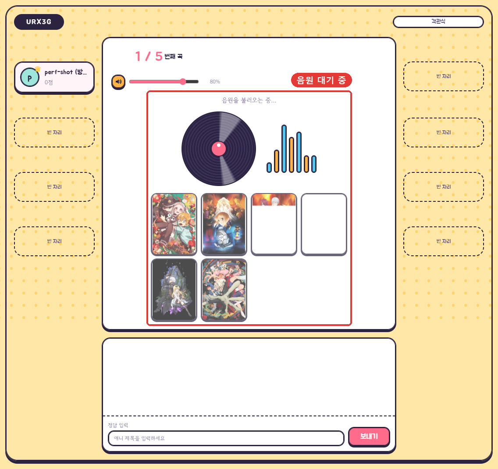
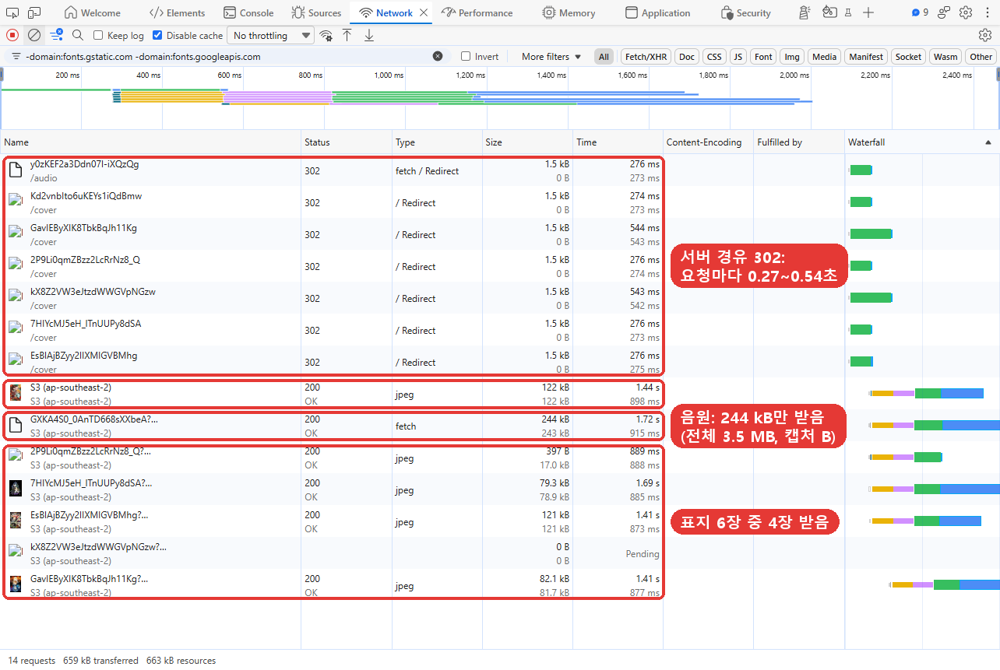
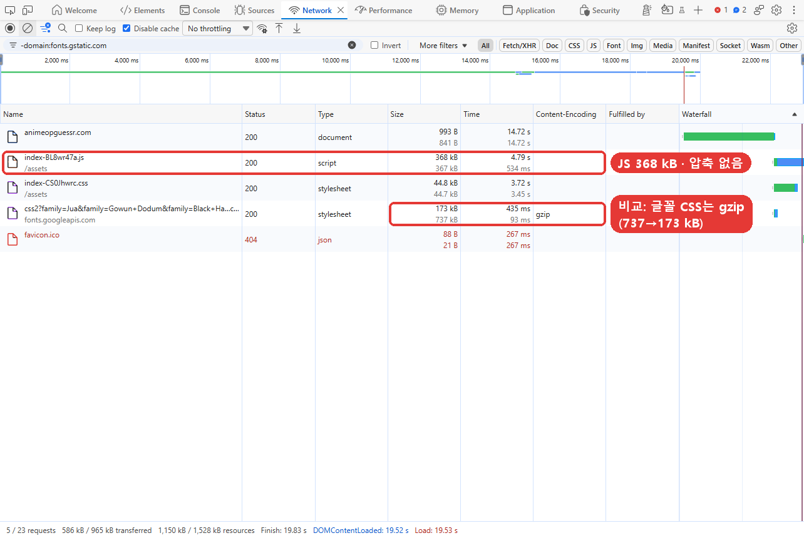

# SongRush 성능 보고서: 곡 준비 대기 시간

> **한 줄 요약:** 곡마다 음원을 받느라 5~21초를 기다렸고, 주원인은 원본 고음질 그대로인 음원(곡당 3.6 MB)입니다. 원인을 하나씩 골라 고치고 다시 재서, 그 과정을 5장에 단계별로 기록합니다.

> **문제 → 측정 → 원인 → 개선 후보 → 개선 단계** 순서의 요약본입니다. 캡처의 빨간 표시는 설명을 위해 덧붙인 것이고, 표시 없는 원본은 상세본에 있습니다. 근거, 측정의 한계, 재현 명령은 [상세본](performance-detail.md)에 있습니다.
>
> 용어: **중앙값** 값을 줄 세운 가운데 값 · **kbps** 소리 1초당 데이터 양(클수록 음질과 파일 크기가 큼) · **S3** AWS 파일 저장소 · **302** 서버가 "실제 파일은 저 주소에 있다"고 돌려보내는 응답 · **gzip** 보내기 전에 파일을 압축하는 방식 · **Content-Encoding** 응답이 어떤 방식으로 압축됐는지 표시하는 칸 · **CDN** 사용자 가까이에 파일 사본을 두는 배포망 · **curl** 주소 하나를 명령줄에서 직접 요청해 보는 도구

## 1. 문제

플레이어는 곡마다 **"음원을 불러오는 중..."** 화면에서 기다립니다. 객관식 정답 형식이 생긴 뒤로 곡마다 표지 4~8장을 더 받게 되면서, 대기가 길다는 지적이 나왔습니다(2026-11-09).

*캡처 A. 객관식 곡의 준비 중(실제 사이트, 2026-11-10 10:00 KST). 아래 개발자 도구 화면에서 표지 6장 중 4장은 받았지만, 음원은 전체 3.5 MB(다 받은 뒤의 캡처 B에서 확인) 중 **244 kB**만 받은 상태입니다. 위 게임 화면은 그 약 2초 뒤입니다.*

## 2. 측정

- **도구:** 직접 만든 `perf/run.py`가 실제 사이트에서 Edge 브라우저로 방을 만들고 **채팅 5곡, 객관식 5곡**을 진행하며 기록합니다. 개발자 도구 화면은 `perf/devtools_shot.py`로 찍습니다.
- **핵심 지표:** 준비 신호(서버가 "다음 곡을 받아라"고 보내는 신호)부터 **음원 다운로드 완료까지의 시간**입니다.
  - 처음에는 "곡 시작까지의 시간"을 쟀습니다. 그런데 서버가 25초가 지나면 무조건 곡을 시작하므로, 이 값은 25초를 넘을 수 없었습니다. 검토에서 이를 발견해 상한이 없는 지표로 바꿨습니다([상세 2.4](performance-detail.md#24-측정-방식에서-바로잡은-함정)).
- **환경:** 한국의 PC 1대와 플레이어 1명으로 쟀습니다(실제 방은 가장 느린 사람을 기다리므로 대기가 더 길 수 있음). 서버와 음원 저장소는 호주 시드니(AWS)에 있습니다.
- **횟수:** 4회, 2026-11-09 23:26 ~ 11-10 01:07 KST에 쟀습니다.

### 기준값

| 실행 (KST) | 채팅: 음원 완료 | 객관식: 음원 완료 | 받는 속도 | 곡 사이 체감 대기 (채팅 / 객관식) |
|---|---|---|---|---|
| 11-09 23:26 | **18.9초** | **21.2초** | 0.18 MB/s | **27.9초 / 30.0초** |
| 11-10 00:33 | 6.8초 | 6.3초 | 0.56 MB/s | 15.7초 / 15.3초 |
| 11-10 00:39 | 9.2초 | 7.0초 | 0.40 MB/s | 18.1초 / 15.6초 |
| 11-10 01:07 | 7.4초 | 4.6초 | 0.53 MB/s | 16.4초 / 13.4초 |

*각 칸은 그 실행 5곡의 중앙값입니다. 곡 사이 체감 대기 = 정답 공개 5초 + 준비 신호부터 곡 시작까지(서버가 25초에서 자름) + 시작 예고 3초이고, 그래서 최대 33초입니다.*

- **보통일 때:** 음원을 다 받기까지 곡당 5~9초 걸렸습니다.
- **느릴 때:** 4회 중 받는 속도가 가장 느렸던 1회(0.18 MB/s)에서는 19~21초 걸렸고, 10곡 중 3곡은 25초 안에 준비를 못 해 서버가 기다리지 않고 곡을 시작했습니다. 그중 객관식 4번째 곡은 음원을 다 받는 데 40.8초가 걸려, 플레이어가 **앞부분 약 13초를 놓쳤습니다**(4회 40곡 중 이 1곡).
- **곡 사이 대기:** 13~30초입니다.
- **변동:** 같은 PC, 같은 회선인데도 받는 속도가 실행마다 0.18~0.56 MB/s로 최대 3배 달랐습니다. 회선 상태가 나쁠 때는 대기가 이렇게까지 길어진다는 사례로 봅니다([상세 3.2](performance-detail.md#32-실행마다-크게-달랐다-회선-상태에-따른-변동)). 측정의 한계는 [상세 3.3](performance-detail.md#33-측정의-한계)에 있습니다.

## 3. 원인

*캡처 B. 캡처 A와 같은 곡을 다 받은 시점. 음원 **3.5 MB에 9.24초**가 걸려 가장 늦게 끝납니다. 표지 6장(79~136 kB)은 1.41~5.49초에 끝납니다. 음원은 0.9초 만에 응답이 시작됐으니, 문제는 응답 대기가 아니라 **내려받는 양**입니다.*

*캡처 C. 채팅 곡 하나. 표지 없이 음원 **3.7 MB에 10.05초**입니다. 표지가 없어도 음원 하나가 대기 시간을 정합니다.*

*캡처 A~D는 2026-11-10 오전에 곡 1개(또는 페이지 1번)를 한 번 잰 것으로, 위 기준값 표(5곡 중앙값)와는 별개입니다.*

| 원인 | 영향 | 근거 |
|---|---|---|
| **음원이 원본 고음질 그대로**: 곡당 중앙값 3.6 MB, 316 kbps | 모든 곡의 준비 시간 (**주원인**) | 캡처 B. 90초를 넘는 부분은 전체의 10%뿐이라 길이보다 음질이 크기를 좌우함 ([상세 4.1](performance-detail.md#41-음원-파일이-필요-이상으로-크다-주원인)) |
| **서버와 저장소가 시드니에 있음** | 모든 다운로드 속도의 상한. 음원·표지마다 서버를 한 번 거치는 데 0.27~0.54초 | 캡처 A의 302 행. 저장소 지역은 계정상 바꾸기 어렵고 CDN은 계정 제약으로 쓸 수 없어서, 보내는 양을 줄이는 것이 첫 대응 ([상세 4.2](performance-detail.md#42-서버와-저장소가-멀다-속도의-상한)) |
| **다음 곡을 미리 받지 않음** | 곡 사이 대기 전체 | 서버가 정답 공개가 끝난 뒤에야 다음 곡 준비를 보냄 ([상세 4.4](performance-detail.md#44-다음-곡을-미리-받지-않는다)) |
| **표지가 화면에 비해 큼** | 객관식 곡당 1.5~2.0 MB를 더 받음. 준비 시간에 대한 영향은 측정으로 확인되지 않음 | [상세 4.3](performance-detail.md#43-표지-이미지가-화면에-비해-크다-객관식의-전송량) |
| **JS·CSS가 압축되지 않음** | 첫 화면 로딩(1.8~3.9초)만 | 캡처 D |

*캡처 D. 첫 화면 로딩(캐시 끔). 사이트 JS `index-BL8wr47a.js`는 전송 368 kB로 원본과 거의 같고, **Content-Encoding 칸이 비어 있습니다**. 같은 화면의 Google Fonts 스타일시트는 gzip으로 압축돼 737 kB가 173 kB로 옵니다. 이 캡처의 로딩 시간(약 20초)은 측정 브라우저 쪽 지연으로 보여 쓰지 않습니다. 같은 시각 curl로는 문서 응답이 0.83~0.90초였고, 첫 화면 로딩은 기준값 측정의 1.8~3.9초입니다.*

## 4. 개선 후보

원인마다 고칠 방법을 정해 두었습니다. 예상 효과는 추정이고, 실제 효과는 5장에서 단계마다 다시 재서 확인합니다([상세 5장](performance-detail.md#5-개선-후보)).

| 원인 | 개선 방법 | 예상 효과 (추정) |
|---|---|---|
| 음원이 원본 고음질 그대로 | 앞 90초만, 96 kbps로 다시 저장 | 곡당 3.6 MB → 약 1.1 MB. 느린 회선에서 약 20초 → 약 6초 |
| 다음 곡을 미리 받지 않음 | 곡이 재생되는 동안 다음 곡을 미리 받기 | 곡 사이 대기가 최소치(정답 공개 5초 + 예고 3초 = 약 8초)에 가까워짐 |
| 표지가 화면에 비해 큼 | 가로 320 px JPEG로 줄이기 | 객관식 곡당 1.5~2 MB → 약 0.15 MB |
| JS·CSS 압축 없음 | 웹 서버(Nginx) gzip 켜기 | JS 367 KB → 약 115 KB |

- **목표:** 느린 회선에서도 모든 곡이 시작 전에 준비되고, 앞부분을 놓치는 곡이 없고, 곡 사이 대기가 10초 이하.
- **비교 방법:** 단계마다 같은 도구, 같은 PC로 최소 3회 재고, 중앙값과 함께 범위(최소~최대)를 적습니다([상세 비교 규칙](performance-detail.md#비교-규칙)).

## 5. 개선 단계

원인을 하나씩 골라 고치고, 고칠 때마다 다시 재서 기록합니다. 현재는 0단계(개선 전 기준값)까지 기록했고, 다음 단계는 4장의 원인 중에서 골라 진행합니다.

| 단계 | 고른 원인 | 한 일 | 음원 완료 중앙값 (채팅 / 객관식) | 가장 느린 실행의 음원 완료 (채팅 / 객관식) | 곡 시작 전 준비 완료 | 앞부분을 놓친 곡 | 곡 사이 대기 |
|---|---|---|---|---|---|---|---|
| 0 | (기준값) | — | 7.6초 / 7.0초 | 18.9초 / 21.2초 | 37/40 | 1/40 | 13~30초 |

*0단계: 음원 완료는 기준값 4회 40곡(형식별 20곡)을 모은 중앙값, 곡 사이 대기는 실행별 중앙값의 범위(최소~최대)입니다. 가장 느린 실행은 받는 속도가 가장 낮았던 회차의 5곡 중앙값입니다([상세 3.1](performance-detail.md#31-4회-측정-요약), [상세 비교 규칙](performance-detail.md#비교-규칙)).*

<!-- 단계를 추가할 때: (1) 위 표에 한 행 추가, (2) 아래 형식의 소절 추가
### N단계: <고른 원인>
- **왜 이 원인을 골랐나:** (4장의 어떤 측정·캡처 때문인지)
- **한 일:** …
- **다시 잰 조건:** 횟수, 날짜와 시각, 실행별 받는 속도
- **결과:** 예상(4장) vs 실제, 전/후 개발자 도구 캡처
- **다음 단계로 고를 원인과 이유:** …
-->
