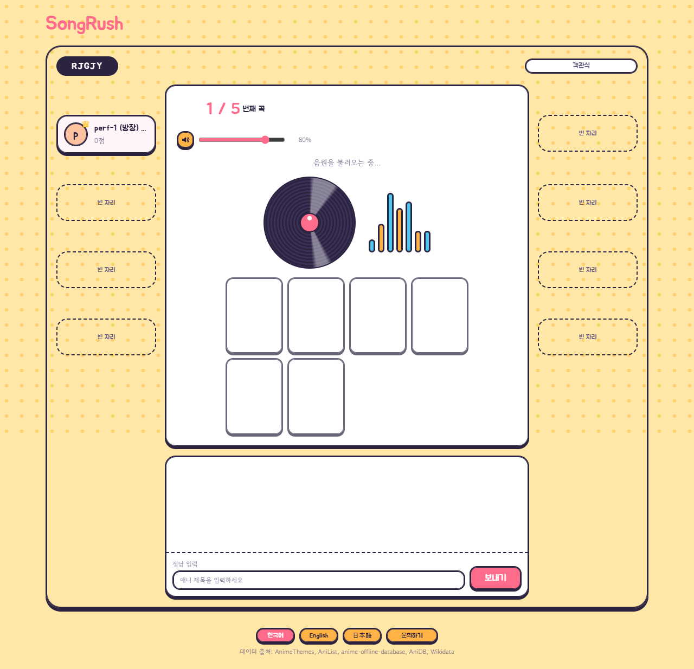
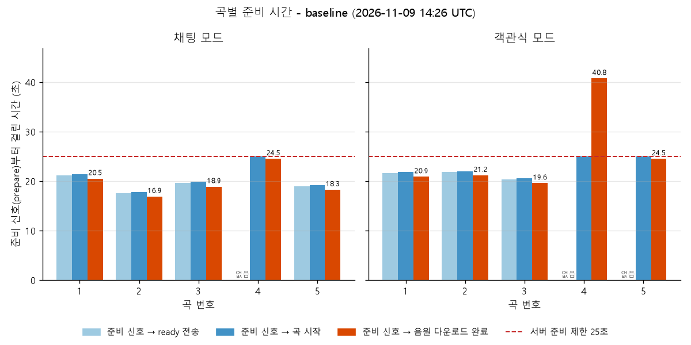
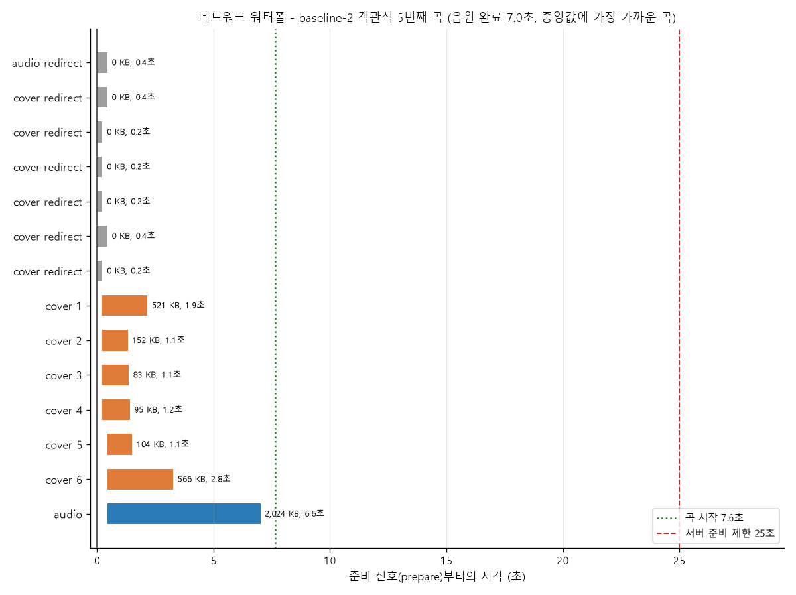
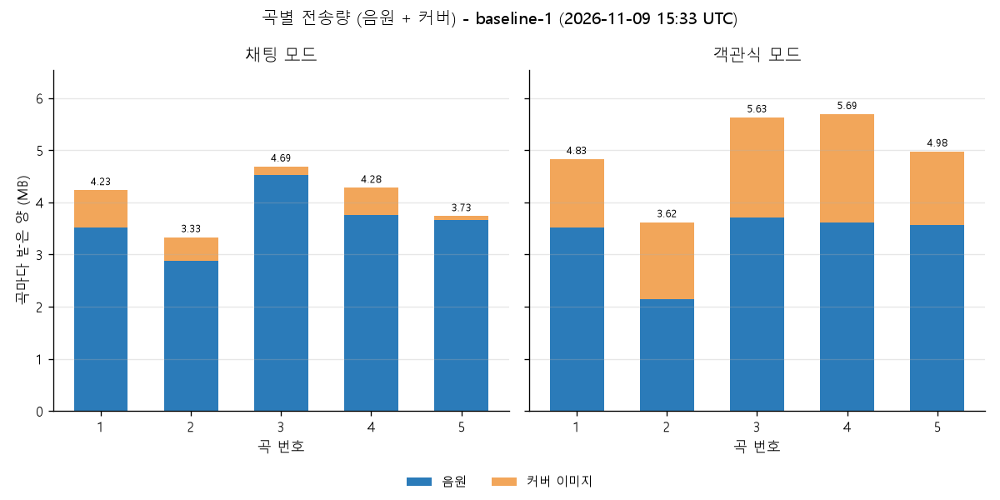

# SongRush 성능 보고서: 곡 준비 대기 시간

> 순서: **1. 문제 → 2. 측정 방법 → 3. 기준값 → 4. 원인 분석 → 5. 개선 계획 → 6. 개선 기록**
> 이 문서의 모든 숫자에는 `perf/results/`의 결과 파일이나 아래에 적은 명령 같은 출처가 있습니다. 기준값은 2026-11-09 ~ 11-10에 측정했습니다.

---

## 1. 문제

플레이어는 곡마다 **"음원을 불러오는 중..."** 화면에서 기다립니다. 객관식 정답 형식(cycle 100)이 생긴 뒤로는 곡마다 표지 이미지 4~8장도 함께 받아야 해서, 기다리는 시간이 더 길게 느껴진다는 지적이 나왔습니다(사장님, 2026-11-09).



*그림 1. 객관식 방의 곡 준비 화면(실제 사이트, baseline-2). 음원을 받는 동안 보기 표지 6칸이 비어 있습니다.*

이 대기 시간이 실제로 얼마나 되는지, 무엇 때문에 생기는지를 측정과 증거로 정리합니다.

---

## 2. 측정 방법

### 2.1 무엇을 재는가
한 곡은 서버에서 다음 순서로 진행됩니다(`backend/src/main/java/com/songrush/game/Room.java`).

```
정답 공개(5초, REVEAL_PAUSE) → prepare(다음 곡 준비 신호) → 각자 음원·표지 다운로드 → ready
→ start(곡 시작 시각, LEAD 3초 전 통보) → 재생(최대 90초)
```

- 서버는 **모두가 ready를 보내거나 25초(PREPARE_TIMEOUT)가 지나면** 곡을 시작합니다.
- 25초 안에 다 받지 못한 사람은 **곡이 이미 시작된 뒤에 늦게** 듣습니다.

| 지표 | 뜻 | 쓰임 |
|---|---|---|
| **prepare → 음원 다운로드 완료** | 준비 신호를 받은 때부터 음원 파일을 다 받을 때까지 | **핵심 지표.** 상한이 없어서 개선 효과가 그대로 드러남 |
| **곡 시작 전 준비 완료 k/N** | N곡 중 곡 시작 전에 ready를 보낸 곡 수 | "늦게 듣는 곡"이 얼마나 되는지 |
| prepare → 곡 시작 | 준비 신호부터 실제 곡 시작까지 | 참고용. **서버의 25초 상한에 막혀 있음** |
| 곡당 음원 크기 / 받는 속도 | 음원 바이트, MB/초 | 원인 분석 |
| 곡당 표지 바이트 | 객관식 보기 표지 합계 | 원인 분석 |
| JS 크기와 압축 여부, 첫 화면 로딩 | 사이트 첫 진입 | 원인 분석 |

### 2.2 측정 도구
- **도구:** `perf/run.py` (Playwright + Edge).
- **진행 방식:** 실제 사이트에 들어가 방을 만들고, **채팅 5곡과 객관식 5곡**을 진행하며 곡마다 위 지표를 기록합니다.
  - 각 곡이 시작되면 그 곡의 다운로드가 끝날 때까지 기다린 뒤 스킵합니다. 이렇게 해야 **곡끼리 인터넷 대역을 나눠 쓰지 않습니다.**
  - 네트워크 요청은 곡별로 나눠 집계하고, 실패하거나 남은 요청도 기록합니다.
- **남기는 것:**
  - 원본 데이터(`perf/results/*.json`)
  - 네트워크 기록 HAR(`perf/results/*.har`, 서명 URL 제거)
  - 화면 캡처(`perf/results/shots/`)
- **그래프:** `perf/report.py`가 결과 파일에서 `docs/perf/`의 그래프를 만듭니다.
- **보안:** presigned URL의 쿼리(서명)는 저장 전에 지우고, `X-Amz-`, `Signature=`, `Credential=` 문자열이 남아 있으면 저장을 거부합니다. 4개 결과와 6개 HAR 모두 검사 결과 0건입니다.

다시 재는 법:
```bash
python -X utf8 perf/run.py --base https://animeopguessr.com/ --songs 5 --label <이름> --env-note "<회선 설명>"
python -X utf8 perf/report.py --results perf/results/<결과>.json [...] --out docs/perf
```

### 2.3 측정 환경
| 항목 | 값 |
|---|---|
| 클라이언트 | Windows 11, Microsoft Edge 156, 한국, 사장님 집 PC 회선 |
| 서버 | AWS EC2 ap-southeast-2 (호주 시드니) |
| 음원·표지 저장소 | S3 ap-southeast-2 (시드니), presigned URL로 직접 다운로드 |
| 사이트 버전 | `index-BL8wr47a.js` (모든 실행 동일) |
| 서버까지 연결 시간 | TCP 연결 약 0.23~0.25초, TLS까지 약 0.47~0.51초 (`curl -w` 3회) |

### 2.4 측정 방식에서 바로잡은 함정
- **처음 기록한 지표:** "prepare → 곡 시작" 시간이었습니다. 그런데 서버는 음원이 안 왔어도 25초가 지나면 곡을 시작합니다. 그래서 이 값은 **음원이 아무리 느려도 25초를 넘지 않습니다.** 첫 측정에서는 10곡 중 7곡이 정확히 약 25초로 찍혔고, 그 중앙값 25.0초는 측정값이 아니라 서버 상수였습니다.
- **두 번째 문제:** 곡을 바로 스킵하면 이전 곡 다운로드가 다음 곡과 겹쳐 대역을 나눠 쓰게 됩니다.
- **바로잡은 방법:** 검토(cycle 102 리뷰)에서 두 문제를 발견했습니다.
  - 핵심 지표를 상한이 없는 **"음원 다운로드 완료까지"**로 바꿨습니다.
  - **곡마다 다운로드가 끝난 뒤 넘어가도록** 했습니다.
  - 첫 측정 결과는 버렸습니다(기록: `docs/cycles/102-perf-baseline.md`).

---

## 3. 기준값

### 3.1 4회 측정 요약
| 실행 | 시각(한국) | 채팅: 준비 완료 | 채팅: 음원 완료 (중앙값) | 객관식: 준비 완료 | 객관식: 음원 완료 (중앙값) | 받는 속도 | 객관식 표지/곡 |
|---|---|---|---|---|---|---|---|
| baseline | 11-09 23:26 | 4/5 | **18.9초** | 3/5 | **21.2초** | 0.18 MB/s | 2,020 KB |
| baseline-1 | 11-10 00:33 | 5/5 | 6.8초 | 5/5 | 6.3초 | 0.56 MB/s | 1,469 KB |
| baseline-2 | 11-10 00:39 | 5/5 | 9.2초 | 5/5 | 7.0초 | 0.40 MB/s | 1,760 KB |
| baseline-3 | 11-10 01:07 | 5/5 | 7.4초 | 5/5 | 4.6초 | 0.53 MB/s | 1,835 KB |
| **전체** | | **19/20** | **중앙값 8.3초** (6.8~18.9) | **18/20** | **중앙값 6.7초** (4.6~21.2) | 0.18~0.56 | 1,469~2,020 KB |

- **공통 값:** 음원 1곡은 중앙값 약 3.6 MB입니다. JS는 367 KB이고 **압축 없이** 전송됩니다(`Content-Encoding` 없음). 첫 화면 로딩은 1.8~3.9초입니다.
- **출처:** `perf/results/2026-11-09-baseline{,-1,-2,-3}.json`과 `perf/README.md`의 표.
- **baseline 실행만 다른 점:** 캡처 기능이 생기기 전 측정이라 HAR과 캡처가 없습니다. 창 크기도 1280×720입니다. 네트워크 수치는 같은 방식으로 쟀습니다.


*그림 2. 실행별 "prepare → 음원 완료" 중앙값. 빨간 점선은 서버의 25초 준비 제한입니다.*

### 3.2 시간대에 따라 크게 달라진다
- **저녁 실행:** 23:26 실행은 받는 속도가 0.18 MB/s였고 음원 완료까지 19~21초가 걸렸습니다.
- **자정 이후 실행:** 0.40~0.56 MB/s로 5~9초였습니다. **같은 PC, 같은 사이트에서 약 3배 차이**입니다.
- **결론:** 개선 효과를 비교할 때는 반드시 **같은 시간대끼리**, 특히 가장 느린 **저녁 시간대를 포함해서** 비교해야 합니다(5장의 검증 규칙).



*그림 3. 저녁 실행(baseline)의 곡별 시간. 객관식 4번째 곡은 음원 완료까지 40.8초가 걸렸습니다. 서버는 25초에 곡을 시작했으므로 이 플레이어는 곡을 약 16초 늦게 들었습니다. "없음"은 곡 시작 전에 ready를 보내지 못한 곡입니다.*

---

## 4. 원인 분석

### 4.1 음원 파일이 필요 이상으로 크다 (주원인)
- 2,998곡 전체의 음원 크기 중앙값은 **3.57 MB**이고 총 10.68 GB입니다.
- 비트레이트 중앙값은 **316 kbps**입니다(p10 192, p90 327). AnimeThemes 원본을 그대로 써서 그렇습니다. 형식은 Ogg Opus입니다.
- 게임은 최대 **90초만** 재생합니다(MAX_PLAY). 1,954곡은 90초보다 길지만, 90초를 넘는 부분은 전체의 **1.07 GB(10%)**에 불과합니다. 그러니 크기의 대부분은 **길이가 아니라 음질(비트레이트)** 때문입니다.
- 워터폴(그림 4)에서도 곡 준비 시간은 **음원 다운로드가 끝나는 시점**이 결정합니다. 표지는 그보다 먼저 끝납니다.

출처: `data/audio-cache/index.json`의 크기와 길이 통계(이 보고서를 쓸 때 계산함), `Room.java` `MAX_PLAY = 90s`.



*그림 4. 객관식 곡 하나의 네트워크 워터폴(baseline-2, 중앙값에 가장 가까운 곡). 음원 2,024 KB가 6.6초 걸려 마지막에 끝납니다. 표지 6장(83~566 KB)은 1~3초 안에 끝나지만, 같은 시간대에 음원과 대역을 나눠 씁니다.*

### 4.2 서버와 저장소가 멀다 (속도의 상한)
- 음원과 표지는 **호주 시드니 S3**에서 직접 받습니다. 한국에서 받는 속도는 0.15~0.57 MB/s였고 시간대에 따라 변했습니다. 서버까지 TCP 연결에만 0.23초 이상 걸립니다.
- 계정 지역이 시드니로 고정돼 있고, CloudFront는 이미 쓰지 않기로 결정했습니다(D-110). 그래서 **보내는 양을 줄이는 쪽**이 현실적인 첫 대응입니다.

### 4.3 표지 이미지가 화면에 비해 너무 크다 (객관식에서)
- 표지 846장: 중앙값 **123 KB**, p90 549 KB, 최대 856 KB입니다. 300 KB를 넘는 것이 258장이고, 271장이 PNG입니다.
- 객관식은 곡마다 표지를 4~8장 받습니다. 기준값에서 **곡당 1.5~2.0 MB**로, 음원 크기의 절반에 이릅니다(그림 5).
- 화면에 보이는 크기는 보기 칸 하나(약 100×133 px)와 정답 카드뿐인데, 원본은 고해상도 포스터입니다.



*그림 5. 곡별 전송량(baseline-1). 객관식 방에서는 표지(주황)가 곡마다 1.3~2.1 MB를 더합니다.*

### 4.4 다음 곡을 미리 받지 않는다
- 서버는 정답 공개 5초가 끝난 뒤에야 다음 곡의 prepare를 보냅니다(`Room.java` `afterReveal` → `prepare(songIndex + 1)`).
- 곡이 재생되는 최대 90초 동안 다음 곡을 받을 시간이 있는데도 쓰지 않습니다. 그래서 **곡 사이마다 다운로드 시간이 그대로 대기 시간**이 됩니다.

### 4.5 첫 화면: JS가 압축되지 않는다
- 화면 코드 JS 367 KB와 CSS 45 KB가 `Content-Encoding` 없이 전송됩니다.
- 빌드 결과 기준으로 gzip을 쓰면 JS는 약 117 KB가 됩니다(Vite 빌드 출력 `gzip: 116.75 kB`).
- 서버의 Nginx에 압축 설정이 없습니다. 저장소에 남은 예전 `deploy/Caddyfile`에는 `encode gzip`이 있었지만, 지금 운영 서버는 Nginx를 씁니다.
- 첫 화면 로딩은 1.8~3.9초입니다. 게임 중 대기에는 영향이 없고 첫 진입에만 영향을 줍니다.

### 4.6 원인 요약
| 원인 | 영향 범위 | 증거 |
|---|---|---|
| 음원 316 kbps, 곡당 3.6 MB | **모든 곡의 준비 시간** (주원인) | 4.1, 그림 4 |
| 시드니까지의 거리와 대역 | 모든 다운로드의 속도 상한 | 4.2, 3.2 |
| 표지 원본 크기 (곡당 1.5~2 MB) | 객관식 곡의 준비 시간 | 4.3, 그림 5 |
| 다음 곡을 미리 받지 않음 | 곡 사이 대기 전체 | 4.4 |
| JS·CSS 압축 없음 | 첫 화면 로딩 | 4.5 |

---

## 5. 개선 계획

효과가 크고 작업이 작은 것부터 진행합니다. 아래 **예상치는 추정**이고, 실제 효과는 6장에 재측정 값으로 기록합니다.

| 순서 | 개선 | 방법 | 예상 효과 (추정) | 하는 사람 |
|---|---|---|---|---|
| 1 | **음원 줄이기** | 앞 90초만, Opus 96 kbps로 다시 저장 | 곡당 3.6 MB → 약 1.1 MB(약 -70%). 저녁 속도(0.18 MB/s) 기준 약 20초 → 약 6초. 총 10.7 GB → 약 3.2 GB라 S3 비용도 줄어듦 | 변환: 개발. S3 재업로드: 사장님 |
| 2 | **표지 줄이기** | 가로 320 px JPEG(품질 80)로 변환 | 장당 약 20~30 KB. 객관식 곡당 1.5~2 MB → 약 0.15 MB | 변환: 개발. S3 재업로드: 사장님 |
| 3 | **다음 곡 미리 받기** | 곡이 재생되는 동안 다음 곡의 음원과 표지를 미리 받음 | 다운로드가 재생 시간(최대 90초) 안에 끝나면 곡 사이 대기가 거의 0초 | 개발 |
| 4 | **JS·CSS 압축** | Nginx `gzip on` (js, css, json) | JS 367 KB → 약 117 KB. 첫 화면이 빨라짐 | 설정: 사장님 (명령은 개발이 제공) |
| 5 | (나중) 저장소 위치·CDN | 1~4 이후에도 부족할 때 다시 검토 | — | 사장님 결정 |

### 검증 규칙
1. **같은 도구, 같은 조건:** `perf/run.py`, 같은 PC와 회선, 채팅·객관식 각 5곡.
2. **같은 시간대 비교:** 개선마다 **최소 3회** 재되, **저녁 시간대(가장 느림) 1회 이상**을 포함하고 기준값의 같은 시간대와 비교합니다.
3. **추가로 남길 것:** `perf/README.md`에 한 줄을 추가하고, 그래프를 다시 만들고, 이 문서 6장에 전/후 표와 그림을 붙입니다.
4. **품질 확인:** 음원 음질(96 kbps)과 표지 화질은 실제 게임 화면과 청취로 확인한 뒤 적용합니다.

---

## 6. 개선 기록

> 개선이 적용될 때마다 이 장에 **전/후 표, 그래프, 캡처**를 추가합니다.

| 날짜 | 개선 | 사이트 버전 | 채팅 음원 완료 (전 → 후) | 객관식 음원 완료 (전 → 후) | 결과 파일 |
|---|---|---|---|---|---|
| (아직 없음) | | | | | |

---

### 부록: 관련 파일
- 측정 도구와 표: `perf/run.py`, `perf/report.py`, `perf/README.md`
- 원본 결과, HAR, 캡처: `perf/results/`
- 그래프: `docs/perf/`
- 작업 기록: `docs/cycles/102-perf-baseline.md`, `docs/cycles/103-perf-report.md`
