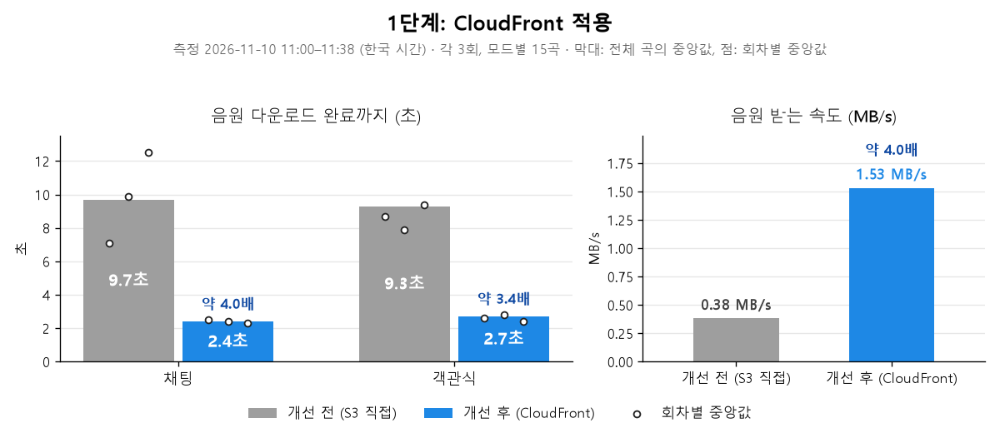
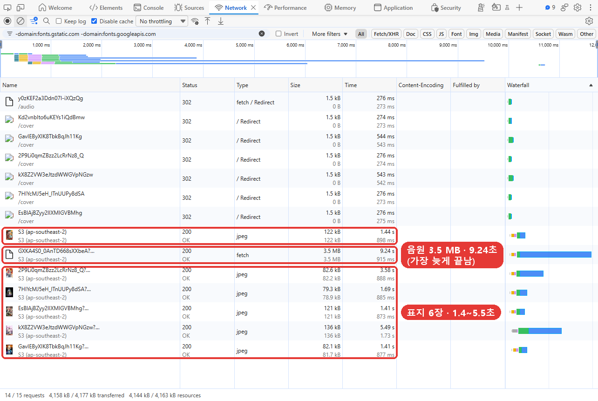
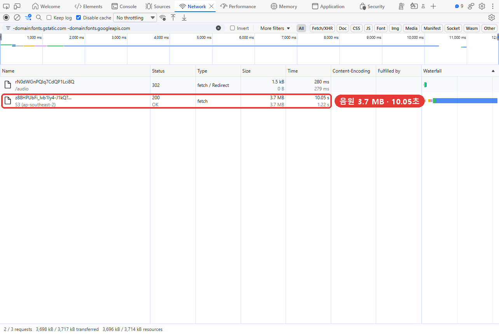
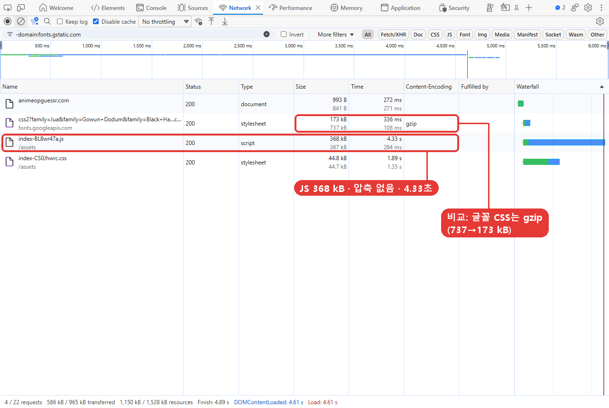
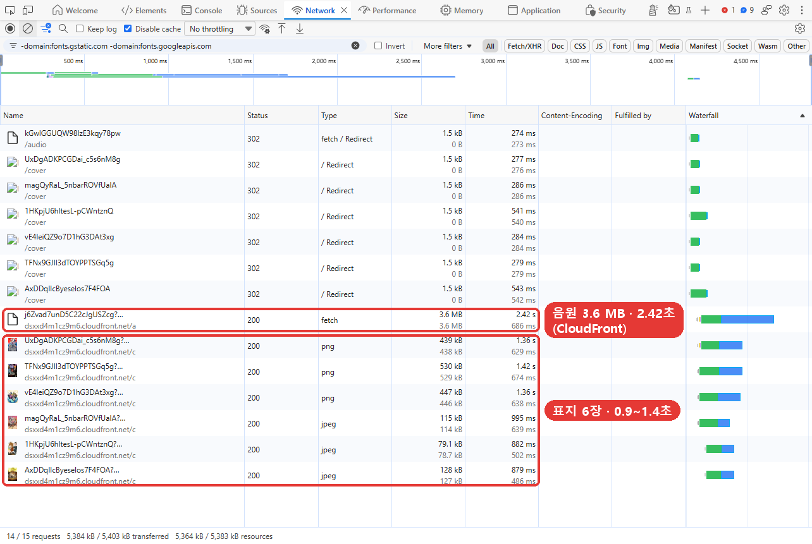

# SongRush 성능 개선: 곡 준비 대기 시간

> **요약:** 곡마다 음원을 받느라 보통 5–10초, 회선이 나쁘면 20초 넘게 기다렸습니다. 측정해 보니 곡당 3.6 MB 음원을 호주 시드니의 저장소에서 한국까지 직접 받는 구조가 원인이었습니다. **CloudFront를 거쳐 받도록 바꿔 음원 대기를 채팅 9.7초 → 2.4초, 객관식 9.3초 → 2.7초로 약 3.4–4배 줄였습니다.** 같은 날 전후를 각 3회 측정한 결과입니다.

> 근거, 측정의 한계, 재현 명령은 [상세본](performance-detail.md)에 있습니다. 캡처의 빨간 표시는 설명을 위해 덧붙인 것이고, 표시 없는 원본은 상세본에 있습니다. 용어는 맨 아래에 정리했습니다.

## 1. 문제

플레이할 때마다 곡 사이의 **"음원을 불러오는 중..."** 화면에서 오래 기다려야 했습니다. 객관식 모드가 생긴 뒤로 곡마다 표지 4–8장도 함께 받게 되면서 더 길게 느껴졌습니다.

*캡처 A. 객관식 곡을 준비하는 중의 게임 화면과, 같은 곡의 네트워크 기록입니다(실제 사이트).*
- *표지 6장 중 4장은 이미 받았지만, 음원은 **244 kB**만 받은 상태입니다. 다 받으면 3.5 MB입니다(캡처 B).*
- *위 7행(302)은 서버가 실제 파일이 있는 저장소 주소로 보내는 응답입니다.*

## 2. 측정

- **도구:**
  - 직접 만든 [측정 스크립트](../perf/run.py)가 Edge 브라우저를 자동으로 조작합니다. 실제 사이트에서 방을 만들고 채팅 모드 5곡과 객관식 모드 5곡을 진행하며 곡마다 시간을 기록합니다.
  - 개발자 도구 화면은 [캡처 스크립트](../perf/devtools_shot.py)로 찍습니다.
- **핵심 지표:** 서버가 다음 곡 준비 신호를 보낸 때부터 **음원 다운로드가 끝날 때까지의 시간**입니다.
  - 처음에는 "곡이 시작될 때까지의 시간"을 쟀습니다. 그런데 서버는 25초가 지나면 무조건 곡을 시작하므로, 그 값은 25초에서 잘려 실제 대기를 보여 주지 못했습니다.
  - 코드 리뷰 중 이를 발견해 상한이 없는 지표로 바꿨습니다([상세 2.4](performance-detail.md#24-측정-방식에서-바로잡은-함정)).
- **환경:** 한국 가정용 회선, PC 1대, 플레이어 1명으로 쟀습니다. 실제 방은 가장 느린 사람을 기다리므로 대기가 더 길 수 있습니다. 서버와 저장소는 AWS 시드니 리전에 있습니다.

### 기준값 (개선 전, 4회)

| 측정 시각 (KST) | 채팅 모드: 음원 완료 | 객관식 모드: 음원 완료 | 받는 속도 | 곡 사이 대기 (채팅 / 객관식) |
|---|---|---|---|---|
| 11-09 23:26 | **18.9초** | **21.2초** | 0.18 MB/s | **27.9초 / 30.0초** |
| 11-10 00:33 | 6.8초 | 6.3초 | 0.56 MB/s | 15.7초 / 15.3초 |
| 11-10 00:39 | 9.2초 | 7.0초 | 0.40 MB/s | 18.1초 / 15.6초 |
| 11-10 01:07 | 7.4초 | 4.6초 | 0.53 MB/s | 16.4초 / 13.4초 |

*각 칸은 그 회차 5곡의 중앙값입니다. 곡 사이 대기는 정답 공개 5초 + 준비 신호부터 곡 시작까지(최대 25초) + 시작 예고 3초입니다.*

- **보통일 때:** 음원을 다 받기까지 5–9초 걸렸습니다.
- **회선이 나쁠 때:** 받는 속도가 0.18 MB/s였던 회차에서는 19–21초 걸렸습니다.
  - 10곡 중 3곡은 25초 안에 준비를 못 해, 서버가 기다리지 않고 곡을 시작했습니다.
  - 그중 1곡은 음원을 받는 데 40.8초가 걸려 **앞부분 약 13초를 듣지 못했습니다**.
- **변동:** 같은 PC, 같은 회선에서도 받는 속도가 회차마다 최대 3배 달랐습니다([상세 3.2](performance-detail.md#32-실행마다-크게-달랐다-회선-상태에-따른-변동)). 측정의 한계는 [상세 3.3](performance-detail.md#33-측정의-한계)에 있습니다.

## 3. 원인

*캡처 B. 캡처 A의 곡을 다 받은 시점입니다.*
- *음원 **3.5 MB에 9.24초**가 걸려 가장 늦게 끝납니다. 표지 6장(79–136 kB)은 1.4–5.5초에 끝납니다.*
- *음원 응답은 0.9초 만에 시작됐습니다. 즉 응답을 기다리는 시간이 아니라 **내려받는 데 걸리는 시간**이 문제입니다.*

*캡처 C. 채팅 모드의 곡입니다. 표지 없이 음원 **3.7 MB에 10.05초**가 걸렸습니다. 표지가 없어도 음원 하나가 대기 시간을 정합니다.*

| 원인 | 영향 | 근거 |
|---|---|---|
| **음원이 원본 고음질 그대로** (곡당 3.6 MB, 316 kbps) | 모든 곡의 준비 시간. 처음에는 이것을 주원인으로 봤습니다 | 캡처 B. 90초를 넘는 부분은 전체의 10%뿐이라, 길이보다 음질이 크기를 좌우합니다([상세 4.1](performance-detail.md#41-음원-파일이-필요-이상으로-크다-주원인)) |
| **서버와 저장소가 시드니에 있음** | 모든 다운로드의 속도 상한. 음원·표지마다 서버를 한 번 거치는 데(302) 0.27–0.54초 | 캡처 A. 저장소 지역은 계정상 바꾸기 어렵습니다([상세 4.2](performance-detail.md#42-서버와-저장소가-멀다-속도의-상한)) |
| **다음 곡을 미리 받지 않음** | 곡 사이 대기 전체 | 서버가 정답 공개가 끝난 뒤에야 다음 곡 준비 신호를 보냅니다([상세 4.4](performance-detail.md#44-다음-곡을-미리-받지-않는다)) |
| **표지가 화면에 비해 큼** | 객관식 곡당 1.5–2.0 MB를 더 받음. 준비 시간에 대한 영향은 측정으로 확인되지 않음 | [상세 4.3](performance-detail.md#43-표지-이미지가-화면에-비해-크다-객관식의-전송량) |
| **JS·CSS가 압축되지 않음** | 첫 화면 로딩 | 캡처 D |

*캡처 D. 첫 화면 로딩입니다(캐시를 끄고 측정).*
- *사이트 JS는 전송 368 kB로 원본과 거의 같고, **Content-Encoding 칸이 비어 있어 압축 없이** 옵니다. 받는 데 4.33초가 걸렸습니다.*
- *같은 화면의 Google Fonts 스타일시트는 gzip으로 압축돼 737 kB가 173 kB로 옵니다.*

*캡처 A–D는 곡 1개(또는 페이지 1번)를 한 번 잰 것이라, 위 기준값 표(5곡 중앙값)와는 별개입니다.*

## 4. 개선 후보

| 원인 | 개선 방법 | 예상 효과 (추정) |
|---|---|---|
| 음원이 원본 고음질 그대로 | 앞 90초만, 96 kbps로 다시 저장 | 곡당 3.6 MB → 약 1.1 MB |
| 서버·저장소가 멀다 | 가까운 CloudFront 엣지를 거쳐 받기 | 받는 속도 상승 (**1단계에서 적용**) |
| 다음 곡을 미리 받지 않음 | 곡이 재생되는 동안 다음 곡을 미리 받기 | 곡 사이 대기가 최소치(정답 공개 5초 + 예고 3초 = 8초)에 가까워짐 |
| 표지가 화면에 비해 큼 | 가로 320 px JPEG로 줄이기 | 객관식 곡당 1.5–2 MB → 약 0.15 MB |
| JS·CSS 압축 없음 | 웹 서버(Nginx)에서 gzip 켜기 | JS 367 kB → 약 115 kB |

- **목표:** 회선이 나쁠 때도 모든 곡이 시작 전에 준비되고, 앞부분을 놓치는 곡이 없고, 곡 사이 대기가 10초 이하일 것.
- **비교 방법:** 단계마다 같은 도구, 같은 PC로 개선 전후를 각 3회 이상 재고, 중앙값과 범위를 함께 적습니다([상세 비교 규칙](performance-detail.md#비교-규칙)).

## 5. 개선 단계

원인을 하나씩 골라 고치고, 고칠 때마다 다시 재서 기록합니다.

| 단계 | 한 일 | 음원 완료 (채팅 / 객관식) | 곡 시작 전 준비 완료 | 앞부분을 놓친 곡 | 곡 사이 대기 |
|---|---|---|---|---|---|
| 0 | — (기준값) | 7.6초 / 7.0초 | 37/40 | 1/40 | 13–30초 |
| 1 | CloudFront를 거쳐 받기 | 9.7 → **2.4초** / 9.3 → **2.7초** | 28/30 → **30/30** | 1/30 → **0/30** | 16.0–21.5 → **11.3–11.9초** |

*0단계: 기준값 4회의 모든 곡을 모은 중앙값입니다. 곡 사이 대기는 회차별 값의 범위입니다.*

*1단계: 2026-11-10에 개선 전 3회(11:00–11:07 시작)를 잰 뒤 개선 후 3회(11:33–11:38 시작)를 쟀습니다. 모드별 15곡씩입니다.*
- *개선 전 값이 0단계보다 2초쯤 느린 것은 그날의 회선 상태 차이로 보입니다.*
- *회선 상태의 영향을 배제하려고, 같은 곡을 두 경로로 번갈아 받아 보는 확인도 했습니다. 결과는 0.25–0.51 → 1.33–1.65 MB/s로 같은 차이였습니다([상세 부록 C](performance-detail.md#부록-c-1단계-같은-파일-번갈아-받기-확인)).*

### 1단계: 서버·저장소가 멀다 → CloudFront

- **왜 이 원인부터 골랐나:**
  - 캡처 B에서 음원은 0.9초 만에 응답이 시작됐지만, 다 받는 데 9초가 넘게 걸렸습니다. 한국에서 시드니까지 직접 연결하면 한 연결의 속도가 0.2–0.6 MB/s에 머뭅니다.
  - 파일을 바꾸지 않고 받는 경로만 바꾸면 모든 곡에 바로 효과가 있습니다.
- **한 일:**
  - 서버는 60초 뒤 만료되는 저장소(S3) 다운로드 주소를 만듭니다. 이 주소의 도메인만 CloudFront 주소로 바꿨습니다(서버 코드 한 곳).
  - 플레이어는 인천의 CloudFront 엣지에 접속합니다(응답 헤더 `x-amz-cf-pop: ICN57-P4`). CloudFront는 AWS 내부망으로 시드니에서 파일을 가져옵니다(CloudFront의 일반적인 동작).
  - 서버 설정 한 줄로 켜고 끌 수 있게 만들어, 같은 날 전후를 비교했습니다.
- **결과:**
  - 음원 대기가 약 3.4–4배 줄었습니다. 받는 속도는 중앙값 0.38 → 1.53 MB/s(약 4배)입니다.
  - 모든 곡이 시작 전에 준비되고, 앞부분을 놓친 곡도 없어졌습니다.

*위는 개선 전(음원 3.5 MB에 9.24초), 아래는 개선 후(음원 3.6 MB에 2.42초)입니다.*
- *개선 후 곡은 표지가 더 커서 전체 5.4 MB로, 개선 전 곡(4.2 MB)보다 컸습니다. 그래도 2초대에 끝났습니다.*
- *주소 칸의 `cloudfront.net`이 CloudFront를 거쳤다는 표시입니다.*

- **설계 판단:**
  - **대안과 비교:**
    - S3 Transfer Acceleration도 같은 AWS 엣지망을 쓰지만, 내려받기 1 GB마다 0.04달러가 일반 전송 요금에 더해집니다.
    - 서울 리전에 저장소를 복제하면 저장 비용과 업로드 관리가 두 배가 되고, 서버는 여전히 시드니에 남습니다.
    - CloudFront는 서버 코드 한 곳과 콘솔 설정만으로 끝나고, 무료 사용량 안에 들어옵니다.
  - **캐시는 쓰지 않습니다:** 주소마다 서명이 달라서 엣지에 저장해 둘 수 없습니다. 그래서 캐시를 끄고, 가까운 엣지 연결과 AWS 내부망의 효과만 씁니다.
  - **보안은 그대로입니다:**
    - 서명 검사는 저장소(S3)가 지금처럼 합니다.
    - 배포 전에 서명이 틀린 요청, 서명이 없는 요청, 만료된 요청이 모두 거절(403)되는 것을 확인했습니다.
    - 저장소의 기존 주소도 서명이 있으면 계속 쓸 수 있어서, 설정을 끄면 바로 이전 방식으로 돌아갑니다.
  - **비용:**
    - CloudFront 종량제의 상시 무료 사용량(매달 전송 1 TB, 요청 1천만 건) 안에 들고, S3에서 CloudFront로 가는 전송은 무료입니다.
    - 곡당 최대 약 5.5 MB라 월 1 TB는 약 18만 곡 분량입니다([상세 부록 D](performance-detail.md#부록-d-1단계-비용-근거-2026-11-10-확인), 2026-11-10 AWS 요금 페이지 기준).
  - **남은 것:** 서버를 한 번 거치는 302 응답(0.27–0.54초)은 그대로입니다.
- **배운 점:**
  - 받는 시간은 "파일 크기 ÷ 받는 속도"입니다. 처음에는 파일 크기를 줄이는 쪽을 먼저 봤습니다.
  - 그런데 파일과 음질은 그대로 두고 경로만 바꿔도 속도가 4배 올랐습니다. **음질을 잃지 않고 먼저 할 수 있는 개선**을 측정으로 찾은 셈입니다.
  - 파일 크기 줄이기는 회선이 나쁠 때를 대비해 여전히 유효한 다음 후보입니다.
- **목표 대비:** "모든 곡이 시작 전에 준비"와 "놓친 곡 0"은 달성했습니다. "곡 사이 대기 10초 이하"는 아직입니다(약 11–12초).
- **다음 후보:**
  - 남은 대기 약 11–12초 중 8초는 정답 공개(5초)와 시작 예고(3초)로 정해진 시간입니다. 나머지 약 3.5초는 음원을 받는 시간(약 2.5초)과 모든 플레이어의 준비를 확인하는 시간입니다.
  - 그래서 다음 후보는 **다음 곡 미리 받기**(남은 3.5초를 재생 중에 미리 받기)와 **음원 줄이기**(회선이 나쁠 때를 위한 여유)입니다.

## 용어

| 용어 | 뜻 |
|---|---|
| 중앙값 | 값을 크기순으로 줄 세웠을 때 가운데 값 |
| kbps | 소리 1초에 쓰는 데이터 양. 클수록 음질과 파일 크기가 큼 |
| S3 | AWS의 파일 저장소 |
| CDN, CloudFront | 사용자 가까운 곳(엣지)에서 연결을 받아 주는 배포망. CloudFront는 AWS의 CDN |
| 302 | 서버가 "실제 파일은 저 주소에 있다"고 돌려보내는 응답 |
| gzip, Content-Encoding | 보내기 전에 파일을 압축하는 방식과, 응답이 어떻게 압축됐는지 표시하는 칸 |
